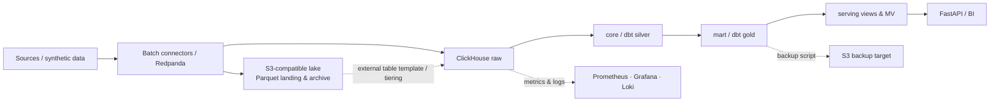
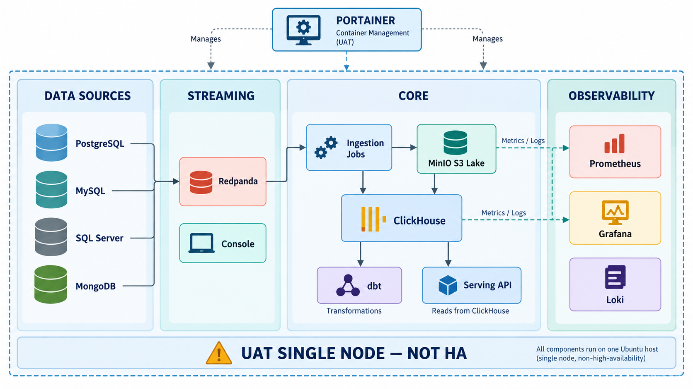
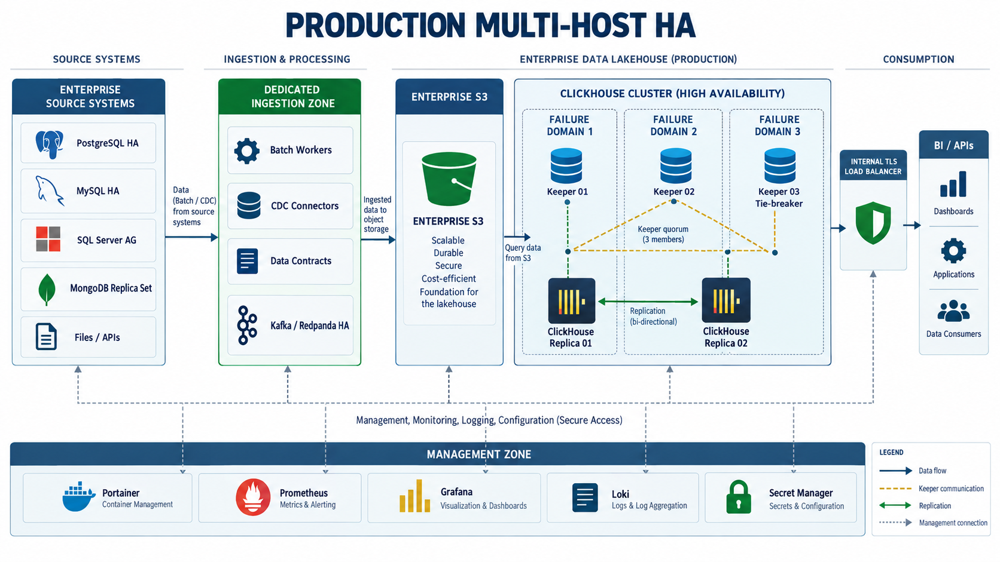
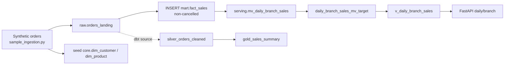
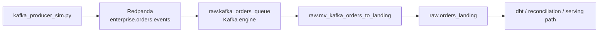

# Enterprise Data Lakehouse Platform

> แพลตฟอร์มตัวอย่างสำหรับพัฒนาและทดสอบ data lakehouse บน ClickHouse, S3-compatible storage และ Docker Compose พร้อมแนวทางกำกับดูแลสำหรับการนำไปใช้ในองค์กร


*ภาพประกอบเชิงแนวคิด: source → ingestion → object storage → ClickHouse raw/core/mart/serving → API/BI; แถวบนคือเส้นทางส่งมอบซอฟต์แวร์ และแถวล่างคือ observability/backup. ภาพไม่ใช่แผนผังพอร์ตหรือการรับรอง HA; ใช้ topology ในเอกสารสถาปัตยกรรมเป็นแหล่งอ้างอิงสำหรับติดตั้งจริง*

### วิธีอ่านภาพ 3D isometric

| ตำแหน่งในภาพ | องค์ประกอบ | ความหมายในระบบและหลักฐาน |
| --- | --- | --- |
| ซ้ายสุด | ฐานข้อมูล ไฟล์ คลาวด์ และแอปพลิเคชัน | ประเภทแหล่งข้อมูลที่แนวคิดรองรับ; UAT มี PostgreSQL, MySQL, SQL Server และ MongoDB จำลองใน [source stack](compose/docker-compose.datasources.yml) ส่วนไฟล์และ REST API มี connector ใน `ingestion/connectors/` |
| กล่องรับข้อมูลซ้ายกลาง | Batch/stream ingestion | [sample loader](ingestion/sample_ingestion.py), connector framework และ Redpanda/Kafka path เป็นคนละวิธีรับข้อมูล; การมีภาพเชื่อมต่อไม่ได้หมายความว่าทุก source ถูกต่อเข้า pipeline แล้ว |
| กลุ่มบล็อกสีน้ำเงิน/ทอง | Object storage และไฟล์เปิด | MinIO เป็น S3-compatible storage ใน UAT; ClickHouse มี S3 cold disk และมี [DDL ตัวอย่าง S3/Parquet/Iceberg](sql/init/06_lakehouse_open_formats.sql) แบบเลือกเปิดเอง. Sample loader ปัจจุบัน **ยังไม่เขียน Parquet ไป S3** |
| ฐานเครื่องเซิร์ฟเวอร์ 4 ระดับกลางภาพ | `raw` → `core` → `mart` → `serving` | แทน namespace ของ ClickHouse ตาม [DDL](sql/init/); dbt และ SQL init มีเส้นทางสร้าง mart ต่างกัน จึงต้องตรวจชื่อ model/table ก่อนต่อ downstream |
| จอภาพทางขวา | ผู้ใช้ข้อมูล | BI/dashboard และ [FastAPI](api/main.py) เรียกข้อมูลจาก serving view และบาง endpoint เรียก mart/core โดยตรง; ต้องปรับ grants ให้สอดคล้องก่อนเปิดใช้งาน |
| แถวบน | Source control → build/CI → registry → deployment | สื่อถึง [GitHub Actions สำหรับ UAT](.github/workflows/publish-uat-images.yml) และ Git-backed Portainer; Jenkins/Harbor/Trivy เป็น production governance baseline ที่ต้องจัดทำและพิสูจน์แยก |
| แถวล่าง | Metrics, dashboard, logs, backup | [Prometheus/Grafana/Loki](compose/docker-compose.observability.yml) และ [backup/restore scripts](scripts/); UAT ยังไม่มี log shipper ไป Loki และ backup script สำรองเฉพาะ `mart`. ภาพวาง backup แยกเชิงแนวคิด แต่ค่า default UAT ชี้ MinIO บน host เดียว |

ลูกศรเรืองแสงในภาพสื่อ **ทิศทางเชิงตรรกะ** ไม่ได้ระบุ protocol, พอร์ต หรือการเชื่อมต่อที่ผ่าน integration test แล้ว; ภาพนี้แสดงวงจรข้อมูล ไม่ได้แสดงจำนวน host จริง. [ไฟล์ prompt ของภาพ](docs/assets/architecture/lakehouse-isometric-overview.prompt.md) เก็บไว้เพื่อให้สร้างภาพรุ่นใหม่ได้โดยไม่สูญเสียเจตนาการออกแบบ.

[คู่มือใช้งาน UAT](docs/UAT_USER_GUIDE.md) · [เริ่มต้น UAT](#เริ่มต้นใช้งาน-devuat) · [ฟีเจอร์](#ความสามารถที่มีใน-repository) · [Workflow](#workflow-ของข้อมูลและการพัฒนา) · [สถาปัตยกรรม](#สถาปัตยกรรมและขอบเขตสภาพแวดล้อม) · [เอกสาร](#เอกสารประกอบ)

## ภาพรวมและสถานะ

Repository นี้รวม Compose stacks, ClickHouse DDL, dbt models, Python ingestion/orchestration, FastAPI, monitoring, governance checks และ runbooks สำหรับวงจรข้อมูลตัวอย่างตั้งแต่รับข้อมูลจนถึงการให้บริการวิเคราะห์ ใช้ **Ubuntu 24 LTS, Docker Engine/Compose V2 และ ClickHouse 26.8 LTS** เป็น baseline ตาม [AGENTS.md](AGENTS.md).

**สถานะที่ควรเข้าใจ:** ผู้ดูแลแจ้งว่าติดตั้ง UAT แล้ว และภาพ Portainer ที่ให้มาแสดง stack entries ครบ 4 รายการ; ภาพยังไม่ยืนยัน container health หรือผล integration tests. DEV/UAT ใน repo เป็น **single-host** สำหรับ functional test และ benchmark จึงไม่ใช่ high availability. มี [ชุด PROD Single Node](docs/PROD_SINGLE_NODE_INSTALLATION_GUIDE.md) สำหรับเริ่ม ClickHouse foundation บน host เดียวโดยไม่มี HA; ส่วนไฟล์ production หลาย host เป็นแบบออกแบบ/ชุดตั้งต้นสำหรับการขยาย. ทั้งสองทางยังต้องกำหนด IP/DNS, image digest, secret manager, network policy, backup/restore และผ่าน human sign-off ก่อนรับข้อมูลจริง; เส้นทาง HA ต้องมี replication/failover test เพิ่ม. ไม่ควรตีความไฟล์หรือรายงานการทดสอบที่ commit ไว้ว่าเป็นหลักฐานของสภาพแวดล้อมปัจจุบัน.

### 📚 เอกสารและคู่มือการใช้งานระบบ (Key Documentation)

- 🧰 **[คู่มือใช้งานทุกระบบบน UAT (UAT User Guide)](docs/UAT_USER_GUIDE.md)**: ขั้นตอนตรวจและใช้งาน 4 Portainer stacks, sources, streaming, ClickHouse, dbt, API, BI, observability, governance, AI/FinOps และ backup/DR
- 📘 **[คู่มือการพัฒนาระบบ (Developer Guide)](docs/DEVELOPER_GUIDE.md)**: สถาปัตยกรรม, การเขียน DDL, การพัฒนา dbt models, การต่อ Ingestion, และ AI Prompt Template
- 📕 **[คู่มือการติดตั้งและการใช้งานจริง (Operations & User Manual)](docs/OPERATIONS_MANUAL.md)**: การเตรียมเครื่อง, การติดตั้งบน Ubuntu 24 LTS, การบริหาร Portainer, การต่อ Power BI/DBeaver, และการกู้คืน DR
- 🧪 **[คู่มือ Deploy UAT Single Node](runbooks/01_portainer_git_stack_deployment.md)**: Portainer 4-stack deployment สำหรับ UAT
- 🏭 **[คู่มือ Deploy Production Multi-Host](runbooks/04_portainer_prod_deployment.md)**: Production readiness gates และ 3-failure-domain deployment
- 🧱 **[คู่มือเริ่ม PROD แบบ 1 Node](docs/PROD_SINGLE_NODE_INSTALLATION_GUIDE.md)**: ClickHouse foundation แบบ host เดียว, image/Compose เฉพาะ PROD, Published Ports, preflight และเกณฑ์รับข้อมูลจริง; ไม่มี HA
- 🧩 **[คู่มือติดตั้งและใช้งาน PROD ทีละโหนด](docs/PROD_INSTALLATION_AND_OPERATIONS_GUIDE.md)**: ข้อกำหนด host, network/Published Ports, ลำดับ Node 03 → 01 → 02 → ClickHouse replicas, verification, การใช้งานและ sign-off
- 🧭 **[UAT Architecture Design](docs/architecture/UAT_ARCHITECTURE.md)**: Single-node topology, stacks, networks และ data flow
- 🏗️ **[Production Architecture Design](docs/architecture/PROD_ARCHITECTURE.md)**: Multi-host HA target architecture และ security zones
- 🗺️ **[พจนานุกรมข้อมูลและผังสายธารข้อมูล (Data Catalog & Lineage)](docs/DATA_CATALOG.md)**: Interactive Mermaid Data Lineage, Table Dictionary, SLA, PII Classification และ Retention
- 🏆 **[รายงานผลการทดสอบรับรองระบบระดับองค์กร (Enterprise Acceptance Test Report)](docs/ENTERPRISE_ACCEPTANCE_TEST_REPORT.md)**: ผลการทดสอบรับรองความสมบูรณ์ 12/12 โมดูล (100% Passed) ตามมาตรฐาน AGENTS.md
- 📗 **[กฎบัตรวิศวกรรมความปลอดภัย (AGENTS.md)](AGENTS.md)**: นโยบายการควบคุมความปลอดภัย Zero-Trust, Least Privilege และ Human Approval Gates

รายงาน Acceptance ข้างต้นเป็นผลที่บันทึกไว้ในเอกสาร ณ เวลาที่รัน; หลายรายการใน suite เป็น static/dry-run checks จึงไม่ใช่ผลทดสอบ live environment, backup/restore หรือการรับรอง production ปัจจุบัน.

## สถาปัตยกรรมและขอบเขตสภาพแวดล้อม



| ส่วน | สิ่งที่มีใน repo | ขอบเขต |
| --- | --- | --- |
| DEV/UAT core | [compose/docker-compose.dev.yml](compose/docker-compose.dev.yml): MinIO, ClickHouse, dbt runner (profile `tools`), serving API (profile `api`), RustFS (profile `rustfs`) | host เดียว; RustFS เป็นทางเลือก |
| UAT source/streaming | [datasources](compose/docker-compose.datasources.yml) สำหรับ PostgreSQL, MySQL, SQL Server, MongoDB; [streaming](compose/docker-compose.streaming.yml) สำหรับ Redpanda/Console | แยก stack; ใช้ข้อมูล synthetic/masked |
| Observability | [Prometheus/Grafana/Loki](compose/docker-compose.observability.yml) และ alert/dashboard provisioning | stack แยก ใช้ external shared network |
| Production target | [node 1](compose/docker-compose.prod-node1.yml), [node 2](compose/docker-compose.prod-node2.yml), [Keeper 3](compose/docker-compose.prod-keeper3.yml) | เป้าหมาย 1 shard × 2 replicas และ Keeper 3 failure domains; ต้องตรวจจริงก่อนใช้ |

### ภาพ deployment: UAT หนึ่ง host



เส้นประสีน้ำเงินล้อม **Ubuntu host เดียว** ที่แบ่งเป็นสี่ stack: Data Sources ทางซ้าย, Streaming ถัดมา, Core ตรงกลาง และ Observability ทางขวา. Portainer ด้านบนเป็น management plane สำหรับจัดการ Git-backed stacks. Core มี MinIO, ClickHouse, dbt runner และ Serving API; ingestion job ในภาพหมายถึงสคริปต์ที่รันจาก host/runner ที่อนุมัติ **ไม่ใช่ service ที่ทำงานตลอดใน Compose**. ลูกศร metrics/logs เป็นความตั้งใจเชิงสถาปัตยกรรม: [Prometheus UAT config](monitoring/prometheus/prometheus.uat.yml) scrape ClickHouse/MinIO, Grafana มี provisioning แต่ Loki ยังไม่มี log shipper ใน Compose. กรอบล่าง “UAT SINGLE NODE — NOT HA” ย้ำว่า volumes และบริการทั้งหมดแชร์ failure domain เดียว. ดู network, port mapping และ failure boundary ที่ [UAT Architecture](docs/architecture/UAT_ARCHITECTURE.md).

### ภาพ deployment: เป้าหมาย Production HA



ภาพนี้เป็น **target architecture ที่ยังไม่พร้อม deploy**. แหล่งข้อมูลและ dedicated ingestion zone อยู่ซ้าย; enterprise S3 แยกออกจาก ClickHouse cluster; Keeper 01/02/03 กระจายข้าม 3 failure domains เพื่อ quorum และ ClickHouse Replica 01/02 อยู่คนละ domain. ฝั่งขวาเป็น internal TLS load balancer ไปยัง BI/API. Management zone ด้านล่างรวม Portainer, monitoring, logging และ secret manager ซึ่งต้องออกแบบติดตั้งจริง. ลูกศรสีเขียวสื่อ replication; เส้นประสีเหลืองสื่อ Keeper quorum; เส้นประสีเทาสื่อ management. ภาพ **ไม่ใช่หลักฐาน** ว่า TLS, load balancer, cross-host network, secret manager หรือ failover ถูกติดตั้งและผ่านทดสอบแล้ว. ข้อกำหนดและ blocking gaps อยู่ใน [Production Architecture](docs/architecture/PROD_ARCHITECTURE.md) และ [Production Runbook](runbooks/04_portainer_prod_deployment.md).

ClickHouse แยกฐาน `raw`, `core`, `mart`, `serving` ใน [SQL init](sql/init/). `raw.orders_landing` เป็น landing table; `core.dim_customer` และ `core.dim_product` ใช้ ReplacingMergeTree; `mart.fact_sales` และ `serving.v_daily_branch_sales` รองรับการวิเคราะห์และ pre-aggregation. ตาราง raw/core มี technical metadata ตาม policy. [S3/Parquet/Iceberg DDL](sql/init/06_lakehouse_open_formats.sql) เป็น **optional parameterized migration** ที่ไม่ได้รันอัตโนมัติใน UAT image; ต้องเตรียม dataset/catalog และ credentials ก่อนใช้.

### Data model, storage และ lineage

| ชั้น | Object ที่นิยามไว้ | Engine/หน้าที่ | เส้นทางที่เติมข้อมูล |
| --- | --- | --- | --- |
| Raw / Bronze | `raw.orders_landing` | `MergeTree`, partition รายเดือนจาก `order_timestamp`, เก็บ source payload และ 7 metadata fields | sample loader, connector framework หรือ Kafka MV |
| Core / Silver | `core.dim_customer`, `core.dim_product`; dbt model `silver_orders_cleaned` | dimension CDC ใช้ `ReplacingMergeTree(_source_updated_at, _is_deleted)`; dbt silver สร้างตารางที่สะอาดและคำนวณ `net_amount` | sample loader seed dimensions; dbt อ่าน source `raw.orders_landing` |
| Mart / Gold | `mart.fact_sales`; dbt model `gold_sales_summary` | fact_sales ใช้ `MergeTree`, monthly partition, TTL ย้ายไป S3 cold volume หลัง 90 วันและลบหลัง 7 ปี; dbt gold สรุปยอดรายวันตามสาขา | sample loader insert fact_sales โดยตรง; dbt gold อ่าน dbt silver |
| Serving | `serving.daily_branch_sales_mv_target`, `serving.mv_daily_branch_sales`, `serving.v_daily_branch_sales` | `AggregatingMergeTree` เก็บ aggregate states; MV ตอบสนองการ insert ใน `mart.fact_sales` และ view merge state ให้ API/BI อ่าน | SQL init 03 สร้าง objects; ข้อมูลไหลจาก fact_sales |
| External formats | `raw.ext_s3_orders_landing`, `mart.ext_s3_sales_archive`, `raw.ext_iceberg_orders` | DDL template สำหรับ query Parquet/Iceberg บน S3 | optional migration; ไม่อยู่ใน UAT image bootstrap |

ทุกแถวของ `raw` และตาราง `core` ที่กำหนดใน DDL มี `_source_system`, `_source_table`, `_ingested_at`, `_source_updated_at`, `_batch_id`, `_record_hash` และ `_is_deleted`. `_record_hash` เป็น checksum เพื่อเปรียบเทียบ record; ตัวอย่างใช้ MD5 จึงไม่ควรใช้แทนกลไกด้านความปลอดภัย. การอ่านตาราง CDC ต้องจัดการ version/tombstone ด้วย `FINAL` หรือ argMax logic ตาม use case; การ merge เบื้องหลังไม่ได้รับประกันผล dedup แบบทันที. Partition ใช้ granularity รายเดือน; `ORDER BY` ของ fact table เรียง `(sale_date, branch_id, product_id, customer_id)` สำหรับรูปแบบ query ที่นิยามไว้ และต้องทบทวนกับ workload จริง.

[storage_configuration.xml](clickhouse/config.d/storage_configuration.xml) นิยาม local default disk, S3 cold disk และ policy `hot_to_cold`. การมี TTL/storage policy ใน DDL เป็น **configuration intent**; ต้องทดสอบ object storage, free space, การย้าย parts และการ query หลังย้ายจริง. [Data Catalog](docs/DATA_CATALOG.md) กับ [catalog generator](scripts/generate_catalog.py) ช่วยจัดเอกสาร schema/lineage จากไฟล์ SQL; ไม่ได้แทน data catalog service หรือ schema registry ที่ deploy แล้ว.

## ความสามารถที่มีใน repository

| ด้าน | Implementation / วิธีใช้ | หมายเหตุสถานะ |
| --- | --- | --- |
| Batch ingestion | [sample_ingestion.py](ingestion/sample_ingestion.py) สร้าง orders ตัวอย่างและเขียน `raw.orders_landing`/`mart.fact_sales`; [connectors](ingestion/connectors/) สำหรับ PostgreSQL, REST API, file drop | โค้ด sample ยังไม่อัปโหลด Parquet/JSON ไป S3 แม้ docstring ระบุไว้; ไม่ได้ผูก source stack ทุกตัวเข้ากับ pipeline อัตโนมัติ |
| Streaming | [producer จำลอง](streaming/kafka_producer_sim.py), Redpanda และ [Kafka engine/MV](sql/init/05_kafka_streaming.sql) | ต้องเปิด streaming stack และเตรียม topic/connectivity |
| Transformation | [dbt project](dbt/dbt_project.yml): `raw.orders_landing` → `silver_orders_cleaned` → `gold_sales_summary` พร้อม source/test definitions | dbt model และ SQL init mart เป็นคนละเส้นทาง; ตรวจ schema จริงก่อนเชื่อม downstream |
| Data quality & governance | [reconciliation](data_quality/reconciliation.py), [anomaly detector](data_quality/anomaly_detector.py), [data contract validator](governance/validate_contract.py), [catalog generator](scripts/generate_catalog.py), [policy linter](governance/policy_linter.py) | contract validator เป็น CLI; ยังไม่ใช่ automatic gate ของทุก ingestion path |
| Serving | [FastAPI](api/main.py): `/health`, `/api/v1/sales/daily-summary`, `/branch/{branch_id}`, `/top-products`, `/api/v1/metrics/data-quality`, `/cluster-stats` | endpoint บางตัวอ่าน `core`/`mart`; ตรวจ grants ให้ตรง role ก่อนเปิดใช้งาน |
| AI / semantic demos | [Text-to-SQL](ai_assistant/text_to_sql.py) กับ [SQL guardrails](ai_assistant/guardrails.py), [incident triage](ai_assistant/incident_triage.py), [vector demo](ai_assistant/vector_search.py), [semantic metrics](semantics/metrics.yml) | vector demo ใช้ deterministic in-memory embeddings; ไม่ใช่บริการ vector search ที่ deploy แล้ว |
| Operations | [orchestrator](orchestration/pipeline_orchestrator.py), [Airflow DAG](orchestration/airflow_dag.py), [FinOps analyzer](finops/query_cost_analyzer.py), benchmark/stress scripts | Airflow เป็น DAG source; ไม่มี Airflow service ใน Compose |
| Backup/DR | [backup](scripts/backup_clickhouse.sh), [restore drill](scripts/restore_test.sh), [runbook](runbooks/02_backup_and_restore_operations.md) | backup script ปัจจุบันสำรอง **`mart`**; ความครอบคลุมเต็มระบบและ RPO/RTO ต้องพิสูจน์แยก |

### M01–M04: Sources, streaming, lake storage และ ClickHouse

**Source connectivity (M01).** [BaseConnector](ingestion/connectors/base_connector.py) กำหนดวงจร `extract → enrich_metadata → load_to_clickhouse → save_watermark` โดยเก็บ watermark ในไฟล์ใต้ `.state/` และส่ง `JSONEachRow` ไป `raw.orders_landing`. [PostgresConnector](ingestion/connectors/postgres_connector.py) ใช้ `updated_at`/watermark และ batch limit; [RestApiConnector](ingestion/connectors/rest_api_connector.py) รองรับ pagination, bearer token จาก environment และเว้นจังหวะ request; [FileDropConnector](ingestion/connectors/file_drop_connector.py) อ่าน CSV/JSON แล้วเลื่อนไฟล์ไป archive. Connectors เป็น Python modules สำหรับนำไปประกอบกับ runner; ไม่มี scheduler/long-running connector service สำหรับทั้งสามตัวใน Compose. Local watermark และการย้ายไฟล์ก่อน load สำเร็จต้องพิจารณา replay/idempotency ก่อนใช้กับข้อมูลสำคัญ.

**Synthetic batch path.** [sample_ingestion.py](ingestion/sample_ingestion.py) สร้าง 500 orders ต่อการรัน, seed ตัวอย่าง customer/product, insert ไป `raw.orders_landing` และคัดเลือก non-cancelled orders เพื่อ insert `mart.fact_sales`; จากนั้น query counts ของ raw, mart และ serving. Script นี้เป็น demo และการรันซ้ำอาจเพิ่ม records ซ้ำ. แม้มีตัวแปร S3 และคำอธิบายใน docstring แต่ไม่มี call ที่เขียน object/Parquet ไป S3 ใน implementation ปัจจุบัน.

**Streaming path (M02).** [streaming stack](compose/docker-compose.streaming.yml) มี Redpanda broker เดียวกับ Console ใน UAT. [producer](streaming/kafka_producer_sim.py) สร้าง event สังเคราะห์; [`raw.kafka_orders_queue` และ MV](sql/init/05_kafka_streaming.sql) ใช้ Kafka engine, topic `enterprise.orders.events`, consumer group `clickhouse_orders_consumer` และแปลง event ให้มี technical metadata ก่อนลง raw. เป็น Kafka-compatible ingestion demo; ยังไม่ใช่ source CDC connector ที่อ่าน database change log จริง. Redpanda broker เดียวบน host เดียวไม่มี HA.

**Object storage (M03).** Core stack สร้าง MinIO และ bucket init; optional `rustfs` profile เป็น S3-compatible storage อีกตัวสำหรับทดสอบ. S3 cold disk ของ ClickHouse ใช้ `CLICKHOUSE_S3_*` และ `S3_REGION` จาก environment. [Open-format DDL](sql/init/06_lakehouse_open_formats.sql) มี external Parquet landing/archive และ Iceberg template โดยใช้ query parameters; ต้องตรวจ compatibility ของ ClickHouse version/catalog, path และสิทธิ์ S3 ก่อน apply. `sql/init/06` ไม่ถูก COPY เข้า [UAT Docker image](clickhouse/Dockerfile.uat) จึงไม่รันโดยอัตโนมัติ.

**Analytical storage (M04).** [`01_databases.sql`](sql/init/01_databases.sql) สร้าง 4 database; [`02_medallion_tables.sql`](sql/init/02_medallion_tables.sql) สร้าง raw/core/mart; [`03_materialized_views.sql`](sql/init/03_materialized_views.sql) สร้าง serving; [`04_rbac_and_row_policies.sql`](sql/init/04_rbac_and_row_policies.sql) สร้าง role/grant; [`05_kafka_streaming.sql`](sql/init/05_kafka_streaming.sql) สร้าง Kafka path. [ClickHouse UAT image](clickhouse/Dockerfile.uat) pin base patch `26.8.6.5` และติดตั้ง config/SQL 01–05; production Compose ยังใช้ tag `26.8` และต้อง pin patch/digest. [cluster/Keeper configs](clickhouse/config.d/) เป็นส่วนของเป้าหมาย multi-host และต้องทดสอบบน node จริง.

### M05–M08: Transformation, quality, orchestration, serving และ governance

**dbt transformation (M05).** [`sources.yml`](dbt/models/bronze/sources.yml) ประกาศ `raw.orders_landing` และ not-null tests. [`silver_orders_cleaned.sql`](dbt/models/silver/silver_orders_cleaned.sql) คำนวณ order date, net amount, status แบบ uppercase และส่งต่อ metadata; [`gold_sales_summary.sql`](dbt/models/gold/gold_sales_summary.sql) สรุปจำนวน order/customer, units, revenue และ average ต่อวัน/สาขา. [custom dbt test](dbt/tests/test_sales_amount_positive.sql) ตรวจ revenue ติดลบ. dbt gold model กับ `mart.fact_sales` ที่ SQL init สร้างเป็นคนละ object; serving MV อ้าง `mart.fact_sales` จึง **ไม่ได้รับข้อมูลจาก `gold_sales_summary` โดยตรง**. Repo มีเพียง [`profiles.yml.example`](dbt/profiles.yml.example) แต่ `dbt-run` ใช้ `--profiles-dir .` ซึ่งคาดว่าจะพบ `profiles.yml` ใน image; UAT image publication ตรวจเพียงการ build/version ไม่ได้พิสูจน์ `dbt run`. ต้องจัดเตรียม profile ที่เหมาะกับ UAT โดยไม่ฝัง secrets และตรวจ cluster target ก่อนรัน.

**Reconciliation และ anomaly.** [reconciliation.py](data_quality/reconciliation.py) เปรียบเทียบ row counts/ตัวชี้วัดระหว่างชั้นข้อมูลและคืนรายงาน/quality score; [test_rules.py](data_quality/test_rules.py) มี assertions สำหรับ score และยอดขายติดลบ. [anomaly_detector.py](data_quality/anomaly_detector.py) มีฟังก์ชัน freshness, volume Z-score/IQR และ revenue drift แต่ `run_suite()` ใช้ค่าประวัติและเหตุการณ์ตัวอย่างที่ฝังในไฟล์ แม้พิมพ์ว่า “Live ClickHouse Metrics” เมื่อไม่ใส่ `--dry-run`; จึงเป็น statistical demo ไม่ใช่ live monitor หรือ automatic ingestion pause.

**Pipeline orchestration (M06).** [pipeline_orchestrator.py](orchestration/pipeline_orchestrator.py) เรียง `INGESTION → TRANSFORMATION → DATA_TESTS → RECONCILIATION → BACKUP`; แต่ละ step มี retry, elapsed time, audit JSON ใน `orchestration/runs/` และ optional webhook. `--dry-run` แสดงคำสั่งโดยไม่รันภายนอก; `--skip-backup` ปิด backup step; `--continue-on-error` อนุญาตให้ทำขั้นต่อไปแม้ขั้นวิกฤตล้มเหลว. Backup/reconciliation ถูกกำหนด `critical=False` จึงต้องอ่านผลทีละ step ไม่อาศัยเพียงสถานะรวม. [airflow_dag.py](orchestration/airflow_dag.py) เป็นตัวอย่าง DAG สำหรับนำไปติดตั้งใน Airflow ที่เตรียมต่างหาก; repo ไม่มี Airflow Compose service.

**Serving API (M07).** [FastAPI app](api/main.py) เปิด `/docs` และ `/redoc`. `/health` ตอบสถานะของแอปจากโค้ดโดยไม่ query ClickHouse; ไม่ใช่ deep health check. [Sales router](api/routers/sales.py) อ่าน serving aggregate สำหรับ daily/branch และ join `mart.fact_sales` กับ `core.dim_product` สำหรับ top products. [Metrics router](api/routers/metrics.py) เรียก reconciliation ตามคำขอและ query system tables สำหรับ cluster stats. API เปิด CORS แบบ `*` ใน code และ `/top-products` ต้องอ่าน core/mart ขณะที่ `role_api_service` ใน SQL grant อ่านได้เพียง `serving.*`; ต้องแก้ authorization/query path และทดสอบ endpoint ก่อนเปิดให้ผู้ใช้จริง.

| Endpoint | ข้อมูลที่ code อ่าน | ข้อควรตรวจ |
| --- | --- | --- |
| `GET /health` | ไม่มี ClickHouse query | ตรวจ process เท่านั้น |
| `GET /api/v1/sales/daily-summary?days=7&limit=50` | `serving.v_daily_branch_sales` | Query limits 1–90 วัน และ 1–500 แถว |
| `GET /api/v1/sales/branch/{branch_id}?days=30` | `serving.v_daily_branch_sales` | Query limits 1–180 วัน |
| `GET /api/v1/sales/top-products?limit=10` | `mart.fact_sales` + `core.dim_product` | API role grant ปัจจุบันไม่ครอบคลุม |
| `GET /api/v1/metrics/data-quality` | reconciliation queries | ใช้สิทธิ์และ data availability จริง |
| `GET /api/v1/metrics/cluster-stats` | `system.asynchronous_metrics`/`system.parts` | Query expression สำหรับ `query_signal` ต้องตรวจบน ClickHouse จริง |

**Governance (M08).** [orders contract](contracts/orders_contract.yml) ระบุ schema, nullability, ช่วงค่า, allowed statuses, metadata, owner และ SLA ที่เป็นตัวอย่าง; [validator](governance/validate_contract.py) รับ JSON file หรือรัน sample cases. มันยังไม่ได้ถูกเรียกจาก sample loader, connector base หรือ Kafka MV จึงไม่ใช่ pre-ingestion gate ที่บังคับใช้ทุก path. Contract ยอมรับ `COMPLETED`/`PENDING`/`CANCELLED` แต่ [sample generator](ingestion/sample_ingestion.py) ยังสร้าง `PROCESSING`/`SHIPPED` ด้วย; ต้อง reconcile ก่อนเปิด gate จริง. [catalog generator](scripts/generate_catalog.py) อ่าน SQL เพื่อสร้าง Markdown lineage; [policy linter](governance/policy_linter.py) ตรวจ guardrails บางข้อจาก `AGENTS.md`. [semantic metrics](semantics/metrics.yml) นิยามสูตรและมิติ แต่ยังไม่ใช่ semantic API service.

### M09–M12: Observability, delivery, recovery, AI และ FinOps

**Observability และ performance (M09).** [Prometheus UAT](monitoring/prometheus/prometheus.uat.yml) scrape ClickHouse/MinIO ทุก 15 วินาที; [alert rules](monitoring/prometheus/alert_rules.yml) ครอบคลุม query errors, memory, active parts, replication lag, Keeper quorum และ backup overdue. บาง rule อ้าง metrics/topology ที่ต้องตรวจว่ามีใน UAT จริง โดยเฉพาะ Keeper/replication/backup timestamp. [Grafana provisioning](monitoring/grafana/provisioning/) และ [dashboard](monitoring/grafana/dashboards/clickhouse_overview.json) อยู่ใน repo; [Loki](monitoring/loki/loki-config.yml) เก็บข้อมูลใน local filesystem แต่ไม่มี shipper ใน UAT Compose. [benchmark_queries.py](scripts/benchmark_queries.py) วัด latency queries; [stress_test.py](scripts/stress_test.py) วัด concurrency, QPS, latency และ error rate. ค่าในเอกสารเป็นเป้าหมาย/ตัวอย่าง ไม่ใช่ผล benchmark ปัจจุบัน.

**DevOps และ policy-as-code (M10).** [`ci.yml`](.github/workflows/ci.yml) ทำ Compose parse, XML parse, pattern-based secret check และ `py_compile` สำหรับ Python บางไฟล์. [`publish-uat-images.yml`](.github/workflows/publish-uat-images.yml) รับ release tag รูปแบบ `uat-vX.Y.Z`, ปฏิเสธ tag ที่มีแล้ว, build/smoke แล้ว publish 8 UAT images ไป GHCR. [`docker-compose.uat-build.yml`](compose/docker-compose.uat-build.yml) ใช้ build custom images ในเครื่อง; Portainer Git-backed stack ดึง Compose จาก Git และ image จาก registry ตาม [runbook 06](runbooks/06_github_ghcr_uat.md). Production CI/CD baseline GitHub → Jenkins → Harbor → Trivy → Portainer ยังเป็น governance target; UAT GHCR flow ไม่ใช่การแทนที่ production gate โดยอัตโนมัติ.

**Backup และ DR (M11).** [backup script](scripts/backup_clickhouse.sh) ส่ง `BACKUP DATABASE mart TO S3(...)` แบบ synchronous ไป path `backup/clickhouse/backup_<UTC timestamp>/`. [restore script](scripts/restore_test.sh) restore `mart` เป็น `drill_restore`, เปรียบเทียบจำนวนแถวของ `fact_sales` แล้วลบฐาน drill. ดังนั้นการตรวจปัจจุบันครอบคลุม row count ของ table หนึ่ง ไม่ได้พิสูจน์ข้อมูลทุกชั้น, hash/checksum, freshness, RPO หรือ RTO ทั้งระบบ. ก่อนใช้งานจริงต้องตรวจผล SQL/HTTP, backup scope, isolation ของปลายทาง และหลักฐาน restore drill ตาม [runbook 02](runbooks/02_backup_and_restore_operations.md).

**Governed AI (M12).** [text_to_sql.py](ai_assistant/text_to_sql.py) จับ keyword ภาษาไทย/อังกฤษเพื่อเลือก SQL template สำหรับ daily revenue, top branches, AOV หรือ fallback; ไม่มีการเรียก LLM. [guardrails.py](ai_assistant/guardrails.py) ใช้ regex จำกัด SELECT/WITH, ปฏิเสธคำสั่งอันตรายและการอ้าง `raw/system` บางรูปแบบ พร้อมเติม `LIMIT 100` หากไม่มี; regex guardrails ไม่ใช่ SQL parser และยังต้องใช้สิทธิ์ database แบบ read-only. [vector_search.py](ai_assistant/vector_search.py) คำนวณ hash-based 16-dimensional embeddings ในหน่วยความจำจาก runbook corpus ตัวอย่าง; พิมพ์ ClickHouse SQL equivalent แต่ไม่ได้สร้าง/อ่าน vector table จริง. [incident_triage.py](ai_assistant/incident_triage.py) scrub log และจับ signature `TOO_MANY_PARTS`, `TABLE_IS_READ_ONLY`, `MEMORY_LIMIT_EXCEEDED`, `REPLICATION_LAG` พร้อมแนะนำ runbook; เป็น diagnostic CLI ไม่ได้แก้ production โดยอัตโนมัติ.

**FinOps.** [query_cost_analyzer.py](finops/query_cost_analyzer.py) วิเคราะห์ `system.query_log` 7 วันหรือใช้ข้อมูลจำลองเมื่อ `--dry-run`/live query ไม่ได้ แล้วสร้าง [FINOPS_REPORT.md](docs/FINOPS_REPORT.md). ค่า compute cost เป็น estimation จาก heuristic ใน script ไม่ใช่ใบแจ้งค่าใช้จ่ายจริง; ควรระบุว่ารายงานใช้ live หรือ simulation ทุกครั้ง.

## Workflow ของข้อมูลและการพัฒนา

1. **รับข้อมูล:** ทดลอง source containers หรือ sample generator; sample generator เขียน `raw.orders_landing` และเติม `mart.fact_sales` เพื่อสาธิต serving view. การเขียน landing Parquet ไป S3 ยังเป็นงานที่ต้องต่อเพิ่ม. Streaming ใช้ producer → Redpanda → Kafka engine → MV → `raw.orders_landing` เมื่อเปิด stack และตั้งค่าครบ.
2. **แปลงและตรวจ:** dbt สร้าง silver/gold models; dbt tests, reconciliation และ anomaly detector ช่วยตรวจคุณภาพ. [pipeline orchestrator](orchestration/pipeline_orchestrator.py) เรียง ingestion → dbt run → dbt test → reconciliation → backup พร้อม retry/audit JSON และ optional webhook; ใช้ `--dry-run` ดูลำดับก่อน.
3. **ให้บริการ:** SQL init สร้าง mart fact, serving aggregate table/MV/view; FastAPI ใช้ view/fact สำหรับ endpoint ตัวอย่าง. เส้นทาง dbt gold กับ serving view ควรตรวจการเชื่อมโยงตามกรณีใช้งาน.
4. **พัฒนาและส่งมอบ:** เปลี่ยนโค้ด/DDL/Compose → ตรวจ syntax/policy → review → build/publish image → Git-backed Portainer stack. [CI](.github/workflows/ci.yml) ตรวจ Compose, XML, secret pattern และ Python syntax บางไฟล์; [UAT image workflow](.github/workflows/publish-uat-images.yml) build/smoke/publish 8 images ไป GHCR ด้วย immutable tag. Production baseline GitHub → Jenkins → Harbor → Trivy → Portainer เป็น governance target และต้องมีหลักฐานการตั้งค่าจริง.
5. **ปฏิบัติการ:** Prometheus/Grafana/Loki, runbooks, เป้าหมาย backup ไป independent S3 และ non-destructive restore drill. ค่า default UAT ใช้ MinIO บน host เดียว จึงไม่ใช่ DR destination ที่เป็นอิสระ. ผลทดสอบใน [acceptance report](docs/ENTERPRISE_ACCEPTANCE_TEST_REPORT.md) เป็น snapshot ของการรันในอดีต ไม่ใช่การรับรอง runtime ปัจจุบัน; master suite หลายส่วนเป็น dry-run/static checks.

### Workflow A: Batch demo ไปยัง serving view



เส้นทึบคือ demo path ที่ sample loader และ SQL init ใช้จริงเมื่อ services พร้อม. เส้นประคือ dbt path แยก: `gold_sales_summary` ไม่ใช่แหล่งของ serving MV ใน SQL init. การ seed dimensions/insert fact ซ้ำหรือการสร้าง order ID แบบสุ่มทำให้ตัวอย่างนี้ไม่ใช่ exactly-once pipeline; ควรวาง key, dedup และ replay strategy ก่อนใช้กับข้อมูลจริง.

### Workflow B: Streaming events ไปยัง raw



Producer ใช้ simulated events; Kafka MV แปลง timestamp และเติม metadata ก่อน insert. ต้องมี shared `lakehouse-uat-integration` network, Redpanda endpoint `redpanda:29092`, topic และ ClickHouse objects. ค่า `kafka_skip_broken_messages=100` ใน SQL ทำให้บางข้อความเสียรูปถูกข้ามได้; ต้องกำหนดวิธีตรวจ dead-letter/replay และ consumer lag ก่อนใช้ข้อมูลสำคัญ.

### Workflow C: การเปลี่ยนแปลงระบบและ release

1. แก้ schema/model/API/config ใน branch, อัปเดต [contract](contracts/orders_contract.yml), [catalog](docs/DATA_CATALOG.md), tests และ runbook ที่ได้รับผลกระทบ.
2. ตรวจ Compose/XML/Python/SQL ที่เปลี่ยนและ [policy linter](governance/policy_linter.py); ประเมิน backward compatibility, volume/storage impact และ rollback ของ schema/TTL/role.
3. ให้ reviewer หรือ domain owner challenge ผลการเปลี่ยนแปลงตาม [AGENTS.md](AGENTS.md); CI ใน repo ตรวจเพียง subset จึงต้องเพิ่ม test ที่ตรงกับผลกระทบจริง.
4. สำหรับ UAT เลือก local build หรือ release tag ใหม่ให้ [GHCR workflow](.github/workflows/publish-uat-images.yml) build, smoke test และ publish; ตรวจ image digest/result แล้วตั้ง image variables ใน Portainer Git-backed stack.
5. ตรวจ health, data quality, query behavior, monitoring และ rollback path หลัง deploy UAT. Production ต้องผ่าน [readiness gate](runbooks/04_portainer_prod_deployment.md) และ human sign-off แยก; README นี้ไม่ได้อนุมัติการ deploy.

### Workflow D: การเฝ้าระวังและกู้คืน

Prometheus scrape metrics → alert rules → ผู้ปฏิบัติการใช้ [troubleshooting runbook](runbooks/03_troubleshooting_and_failover.md) และ [incident triage CLI](ai_assistant/incident_triage.py) วิเคราะห์ log ที่ sanitize แล้ว. Backup script ส่ง `mart` ไป S3 endpoint ที่กำหนด; สำหรับ DR ต้องเปลี่ยนจาก MinIO default บน host เดียวไปยัง independent object storage. Restore drill ใช้ database ใหม่และเปรียบเทียบ `fact_sales` ก่อน cleanup. การกู้คืนถือว่าผ่านได้เมื่อมี output จริง, ตรวจข้อมูล/เวลาที่วัดจริง และได้รับ review. ค่า RPO ≤ 1 ชั่วโมง/RTO ≤ 4 ชั่วโมงใน policy เป็น **target รอ business owner sign-off**.

## เริ่มต้นใช้งาน DEV/UAT

**ข้อกำหนด:** Docker Engine + Compose V2, Python 3.11 สำหรับ CLI ตัวอย่าง และเครื่องที่จัดสรรทรัพยากรตาม Compose ได้. ใช้ข้อมูลทดสอบเท่านั้น. จัดเตรียม secrets ในเครื่อง/secret manager และอย่า commit `.env`.

1. คัดลอก [`.env.example`](.env.example) เป็น `.env` แล้วเปลี่ยนรหัสผ่าน/keys และค่า endpoint ที่เกี่ยวข้อง. Image variables `*_UAT_IMAGE` ต้องชี้ไปยัง image ที่ build ในเครื่องหรือ publish แล้ว.
2. สร้าง shared networks ที่ core, observability และ streaming stacks ใช้:

   ```bash
   docker network create lakehouse-uat-integration
   docker network create lakehouse-uat-observability
   ```

3. หากใช้ local build แทน registry image ให้เตรียม `dbt/profiles.yml` จาก [ตัวอย่าง](dbt/profiles.yml.example) โดยใช้ environment variables สำหรับ credentials และปรับ/เอา `cluster: cluster_1s_2r` ออกเมื่อทดสอบ single-node UAT. ตรวจว่า profile ถูก COPY เข้า image, อย่าใส่ secret literal หรือ commit profile ที่มี secret. จากนั้น build จาก [UAT build Compose](compose/docker-compose.uat-build.yml), ตั้ง image variables ใน `.env` ให้ตรงกับ tags ที่ build แล้ว และตรวจ configuration ก่อนรัน:

   ```bash
   docker compose --env-file .env -f compose/docker-compose.uat-build.yml build
   docker compose --env-file .env -f compose/docker-compose.dev.yml config --quiet
   docker compose --env-file .env -f compose/docker-compose.observability.yml config --quiet
   ```

4. เริ่ม core และ observability:

   ```bash
   ./scripts/manage.sh start
   ./scripts/manage.sh status
   ```

   Windows PowerShell ใช้ `.\scripts\manage.ps1 start` และ `.\scripts\manage.ps1 status`. ค่า port ตั้งต้นจาก template: ClickHouse HTTP `18123`, MinIO API `19090`/Console `19091`, Grafana `13000`. API profile เปิดด้วย `./scripts/manage.sh api-start` แล้วดู `http://localhost:18000/docs`.

5. ทดลองวงจรข้อมูลเมื่อ service healthy และตั้ง environment สำหรับ Python process ให้ตรงกับ `.env` (การรัน Python จาก host **ไม่ได้อ่าน `.env` อัตโนมัติ**):

   ```bash
   ./scripts/manage.sh ingest
   ./scripts/manage.sh dbt-run
   ./scripts/manage.sh dbt-test
   ./scripts/manage.sh smoke-test
   ./scripts/manage.sh run-pipeline --dry-run
   ```

ใช้ `./scripts/manage.sh streaming-start` และ `stream-produce` สำหรับ streaming demo; `datasources-start` สำหรับ source containers. ดูคำสั่งทั้งหมดใน [manage.sh](scripts/manage.sh) หรือ [manage.ps1](scripts/manage.ps1). หากเลือก Portainer/GHCR UAT ให้ทำตาม [runbook 06](runbooks/06_github_ghcr_uat.md) และ [runbook 01](runbooks/01_portainer_git_stack_deployment.md).

### พอร์ต UAT และการเข้าถึง

| Service | Host port ตั้งต้นใน `.env.example` | วิธีใช้/เครือข่ายที่ควรจำกัด |
| --- | ---: | --- |
| ClickHouse HTTP / Native / Prometheus | `18123` / `19000` / `19363` | ใช้จาก trusted clients/monitoring เท่านั้น |
| MinIO API / Console | `19090` / `19091` | S3 API และ UI ของ UAT |
| RustFS API / Console (optional) | `19094` / `19095` | เริ่มด้วย profile `rustfs` |
| FastAPI (optional) | `18000` | `/docs` และ `/redoc`; จำกัดที่ trusted network |
| Redpanda Kafka / Console | `19092` / `18088` | Streaming UAT; advertised host ต้องตั้งให้ client เข้าถึงจริง |
| Grafana / Prometheus / Loki | `13000` / `19093` / `13100` | Observability UAT |
| PostgreSQL / MySQL / SQL Server / MongoDB | `15432` / `13306` / `11433` / `17017` | Synthetic/masked source stack เท่านั้น |

พอร์ตด้านบนเป็น **host mappings ของ UAT** ไม่ใช่ข้อเสนอให้เปิดบน Internet. ใช้ firewall/VPN, TLS reverse proxy และ credentials ที่เหมาะสมเมื่อมีผู้ใช้ข้าม host. Keeper `9181/9234` และ ClickHouse interserver `9009` ใน production ต้องอยู่ใน private cluster network; Portainer admin `9443` ต้องอยู่ใน management VPN ตาม policy.

### คำสั่งตามงาน

| งาน | Linux/macOS `manage.sh` | ผลที่คาด/ข้อควรระวัง |
| --- | --- | --- |
| สถานะบริการ | `./scripts/manage.sh status` | แสดง core/observability containers |
| เริ่ม/หยุด source UAT | `datasources-start` / `datasources-stop` | Source containers เป็นตัวทดสอบ แยกจาก core |
| เริ่ม/หยุด streaming | `streaming-start` / `streaming-stop` | Redpanda + Console แยก stack |
| สร้าง batch ตัวอย่าง | `ingest` | เขียน raw/fact; อาจเพิ่มข้อมูลซ้ำเมื่อรันอีกครั้ง |
| แปลงและตรวจ dbt | `dbt-run` / `dbt-test` | รัน dbt runner profile `tools` |
| เปิด API | `api-start` | รัน serving API profile `api` |
| ตรวจ service/data | `smoke-test` / `reconcile` | ต้องมี ClickHouse/stack ที่พร้อมจริง |
| ตรวจ workflow โดยไม่รัน | `run-pipeline --dry-run` | แสดง step และเขียน audit record ตาม implementation |
| สร้างเอกสาร catalog | `generate-catalog` | เขียน `docs/DATA_CATALOG.md`; ตรวจ diff ก่อน commit |
| ตรวจ contract | `contract-validate --dry-run` | ใช้ sample cases; หากมี JSON file ให้ใช้ `--data-file` |
| ตรวจ policy | `policy-lint` | Pattern/structure checks ไม่ใช่ security audit เต็มรูปแบบ |
| ทดสอบความเร็ว | `benchmark` / `stress-test` | ต้องกำหนด host/port/user ให้ตรง environment และเก็บผลจริง |
| วิเคราะห์ต้นทุน | `finops-report --dry-run` | สร้างรายงานจากข้อมูลจำลอง; live mode ใช้ `system.query_log` |
| AI demos | `ai-query` / `vector-demo` / `triage --simulate TOO_MANY_PARTS` | Text-to-SQL แบบ template, in-memory vector และ incident signature |
| ตรวจโมดูล | `master-test` | 12-module suite ผสม import, static, dry-run และ CLI checks |
| สำรอง/ซ้อมกู้คืน | `backup` / `restore-drill <backup_id>` | ต้องตั้ง S3/ClickHouse environment และตรวจผลจริง; restore drill สร้างแล้วลบ `drill_restore` |
| ตรวจ stack | `validate` | Compose/XML/secret pattern; ต้องมี Docker และ Bash |

บน Windows ใช้ [`manage.ps1`](scripts/manage.ps1) แทน `manage.sh` สำหรับคำสั่งที่รองรับ. บางคำสั่งเรียก Bash scripts หรือส่ง arguments ต่างจาก Bash wrapper; อ่าน [script](scripts/manage.ps1) ก่อนใช้ โดยเฉพาะ backup/restore และ stress test.

## โครงสร้างโครงการ

```text
AGENTS.md                     Engineering และ AI-governance policy
.env.example                  ตัวอย่าง environment; ห้ามใช้ค่า placeholder ใน production
.github/workflows/
  ci.yml                      Compose/XML/Python และ secret-pattern checks
  publish-uat-images.yml      UAT image build, smoke, GHCR publish
compose/
  docker-compose.dev.yml      UAT core: MinIO, ClickHouse, dbt/API profiles, optional RustFS
  docker-compose.datasources.yml  PostgreSQL/MySQL/SQL Server/MongoDB สำหรับ UAT
  docker-compose.streaming.yml    Redpanda และ Console
  docker-compose.observability.yml  Prometheus/Grafana/Loki
  docker-compose.uat-build.yml     Local build ของ custom UAT images
  docker-compose.prod-node1.yml   Keeper 01 + ClickHouse Replica 01
  docker-compose.prod-node2.yml   Keeper 02 + ClickHouse Replica 02
  docker-compose.prod-keeper3.yml Keeper 03
clickhouse/
  Dockerfile.uat              Base patch image + XML/SQL 01–05
  config.d/                   cluster, Keeper, network, metrics, logging, S3 storage
  users.d/                    Users, roles และ settings profiles
sql/init/
  01_databases.sql            raw/core/mart/serving
  02_medallion_tables.sql     landing, dimensions, sales fact
  03_materialized_views.sql   serving aggregate target/MV/view
  04_rbac_and_row_policies.sql  roles/grants; row policy ยังเป็น template
  05_kafka_streaming.sql      Kafka engine consumer และ raw MV
  06_lakehouse_open_formats.sql  optional S3/Parquet/Iceberg DDL
ingestion/
  sample_ingestion.py         Synthetic orders, dimension seed และ raw/fact insert
  connectors/                 Base, PostgreSQL, REST API และ file drop
streaming/
  kafka_producer_sim.py       Synthetic Kafka event producer
dbt/
  dbt_project.yml             Model configuration
  profiles.yml.example        ตัวอย่าง ClickHouse connection profile
  models/bronze/sources.yml   raw source และ tests
  models/silver/              Cleaned orders
  models/gold/                Daily sales summary
  tests/                      Custom revenue test
orchestration/
  pipeline_orchestrator.py    ขั้นตอน ingestion → dbt → tests → reconciliation → backup
  airflow_dag.py              DAG source สำหรับ Airflow ภายนอก
  runs/                       Audit JSON snapshots ที่มีใน repo
api/
  main.py                     FastAPI app
  routers/sales.py            Sales endpoints
  routers/metrics.py          Data quality/cluster endpoints
data_quality/                 Reconciliation, rule assertions, anomaly demo
governance/                   Contract validator และ policy linter
ai_assistant/                 Text-to-SQL, SQL guardrails, vector demo, incident triage
finops/                       Query cost analyzer
monitoring/
  prometheus/                 UAT scrape config และ alert rules
  grafana/                    Provisioning และ ClickHouse dashboard
  loki/                       Loki config
scripts/                      Developer CLIs, validation, smoke, benchmark, stress,
                              catalog, acceptance, backup และ restore
contracts/orders_contract.yml Orders data contract
semantics/metrics.yml         นิยาม business metrics และ dimensions
docs/                         Guides, UAT/PROD architecture, catalog, reports, images
runbooks/                     Portainer, GHCR/Harbor, troubleshooting, backup/restore
adr/                          Architecture decisions 0001–0005
agents/                       Engineering agent role definitions
```

### จุดเริ่มต้นสำหรับผู้พัฒนา

| เมื่อต้องการแก้ | อ่านไฟล์หลัก | ตรวจผลที่เกี่ยวข้อง |
| --- | --- | --- |
| ตาราง/partition/TTL | [SQL init](sql/init/), [storage config](clickhouse/config.d/storage_configuration.xml), [ADR 0002](adr/0002-clickhouse-medallion-layering.md) | ClickHouse parser/instance, migration compatibility, volume และ S3 readback |
| Ingestion/source schema | [connectors](ingestion/connectors/), [sample loader](ingestion/sample_ingestion.py), [orders contract](contracts/orders_contract.yml) | metadata ทั้ง 7 columns, watermark/replay, contract validator |
| Streaming | [producer](streaming/kafka_producer_sim.py), [Redpanda Compose](compose/docker-compose.streaming.yml), [Kafka DDL](sql/init/05_kafka_streaming.sql) | topic, consumer group, malformed messages, lag |
| dbt/lineage | [models](dbt/models/), [dbt tests](dbt/tests/), [profile example](dbt/profiles.yml.example), [catalog generator](scripts/generate_catalog.py) | profile ใน image, UAT cluster target, `dbt run`/`dbt test`, query ผลลัพธ์, catalog diff |
| API/AI | [API routers](api/routers/), [guardrails](ai_assistant/guardrails.py), [metrics](semantics/metrics.yml) | endpoint behavior, role grants, read-only access และ query bounds |
| Ops/monitoring | [Prometheus](monitoring/prometheus/), [Grafana](monitoring/grafana/), [Loki](monitoring/loki/), [runbooks](runbooks/) | scrape targets/alert expression, dashboard datasource, restore drill |
| Release/Compose | [Compose files](compose/), [CI workflows](.github/workflows/), [UAT runbook](runbooks/01_portainer_git_stack_deployment.md) | `docker compose config`, image smoke/digest, rollback path |

## การตรวจสอบและข้อจำกัดก่อน production

- รัน `docker compose --env-file .env.example -f <compose-file> config`, XML parser, policy linter และ tests ที่เกี่ยวข้องกับการเปลี่ยนแปลง. อย่ารายงานว่า benchmark, backup หรือ restore สำเร็จจากการมี script เพียงอย่างเดียว.
- [RBAC SQL](sql/init/04_rbac_and_row_policies.sql) เป็น baseline/template: ETL grant มี `SELECT`, API grant ครอบคลุม `serving.*` และ monitoring grant ครอบคลุม `system.*`; ต้องทบทวนให้ตรง least privilege ใน [AGENTS.md](AGENTS.md). Row policy ในไฟล์ยังเป็น comment.
- Production Compose ใช้ tag `26.8`/`26.8-alpine` ในบาง service; ต้อง pin **patch/digest** ก่อน production ตาม policy. จำกัด ClickHouse/Keeper/Portainer ports ผ่าน network/VPN จริง.
- กำหนด host IP/DNS, external S3, secret management, capacity, retention, approved RPO/RTO, backup scope, restore/failover evidence และ change approval เป็น **TBD** ตามสภาพแวดล้อมองค์กร. Single-host UAT ใช้แทนหลักฐาน HA ไม่ได้.
- การแก้ Compose/SQL/config ต้องประเมิน backward compatibility, ผลกระทบต่อ volume/storage และข้อจำกัด rollback พร้อม human review ก่อน production promotion.

### หลักฐานการตรวจที่ควรเก็บตามชนิดการเปลี่ยนแปลง

| การเปลี่ยนแปลง | คำสั่ง/หลักฐานขั้นต่ำ | สิ่งที่ผลลัพธ์ยังยืนยันไม่ได้ |
| --- | --- | --- |
| Compose | `docker compose --env-file .env.example -f compose/docker-compose.dev.yml config --quiet` และไฟล์อื่นที่แก้ | Parse ผ่านไม่ได้พิสูจน์ว่า image, network หรือ service พร้อม |
| ClickHouse XML/SQL | XML parser, policy linter, ClickHouse parser/instance ที่ version เป้าหมาย, query/DDL ตาม use case | XML parse ผ่านไม่ได้พิสูจน์ว่า SQL init หรือ storage tiering ใช้งานได้ |
| Ingestion/dbt | contract test กับ payload จริง, `dbt run`, `dbt test`, reconciliation | Sample/dry-run ไม่พิสูจน์ end-to-end จาก source จริง |
| API | health + endpoint integration test ด้วย service role และข้อมูลทดสอบ | `/health` เพียงอย่างเดียวไม่พิสูจน์ ClickHouse connectivity |
| Performance | benchmark/stress test กับ workload, concurrency, dataset และ hardware ที่ระบุ | ตัวเลขจาก simulation หรือตัวอย่างใช้เป็น SLA ไม่ได้ |
| Backup/DR | backup response/result, object verification, restore drill, row/hash reconciliation, elapsed time | การพบ script หรือ row count เท่ากันเพียงอย่างเดียวไม่พิสูจน์ RPO/RTO |
| Security | role/grant review, secret scan, image vulnerability scan, network/TLS test | Pattern-based CI scan ไม่ใช่ vulnerability/penetration assessment |

### Production readiness blockers ที่ทราบจาก runbook

สถานะใน [Production Runbook](runbooks/04_portainer_prod_deployment.md) คือ **NOT READY FOR PRODUCTION**. Compose production บังคับให้ระบุ image variables และ private host IP แล้ว แต่ยังต้องเลือก patch/digest ที่อนุมัติ, ทำ Git-backed stacks แยกช่วง Keeper/ClickHouse และเปลี่ยน SQL init จาก local engines เป็น replicated tables ที่พิสูจน์ได้. งานที่ยังต้องปิดรวมถึง enterprise S3/KMS/backup credentials, observability topology แยกจาก UAT, การจัดการ relative bind mounts ใน Portainer Git Stack, Keeper config ต่อ process/node, service-account environment, TLS, load balancer/VIP, และ deployment ของ ingestion/CDC ใน production. สำหรับ UAT เองต้องจัดเตรียม dbt profile ให้ image ใช้งานได้และตรวจ `dbt run` จริง. ต้องพิสูจน์ quorum, replica DNS/network, failover, load และ restore บน failure domains อย่างน้อย 3 แห่ง พร้อมการอนุมัติจาก Platform, DBA, Security, Network, Data Owner และ Change Manager.

มีข้อจำกัดเชิง implementation ที่ควรตรวจร่วมด้วย: [backup script](scripts/backup_clickhouse.sh) ใช้ `curl -sS` โดยไม่ fail ตาม HTTP error code เสมอและพิมพ์ข้อความ success หลังเรียก; จึงต้องตรวจผล SQL/HTTP และ object ที่สร้าง. [restore script](scripts/restore_test.sh) ใช้ชื่อ database `drill_restore` คงที่และสั่ง `DROP DATABASE` ตอนท้าย; ต้องยืนยันว่า namespace นี้ว่าง/แยกเฉพาะ drill และมี change approval ก่อนรัน. ห้ามใช้ผลจาก [master acceptance suite](scripts/master_e2e_test.py) แทน live DR evidence เพราะ M11 ใน suite ตรวจเพียงการมีไฟล์.

## ทีมผู้เชี่ยวชาญประจำโครงการและแผนยกระดับ production

โครงการมี [ทะเบียนผู้เชี่ยวชาญ A00–A12](agents/README.md) พร้อมขอบเขตงาน ผู้ตรวจทานอิสระ และ Handoff Contract; บทบาทที่ขาดจาก baseline เดิม (A09 Documentation/ADR, A10 BI/Data Product, A11 Capacity/FinOps และ A12 API/AI Application) มี brief ที่เรียกใช้ได้ใน `agents/`. [แผนงาน Production Readiness](docs/PRODUCTION_READINESS_SPECIALIST_WORKLIST.md) จัด P0/P1 จากหลักฐานในโค้ด พร้อมเจ้าของ เกณฑ์ตรวจรับ ลำดับงาน และค่า `TBD` ที่ต้องให้เจ้าของระบบตัดสินใจ. การมีทีมและแผนงานยังไม่ใช่การรับรองว่า production พร้อมใช้งาน; อ่าน [production gate](runbooks/04_portainer_prod_deployment.md) ก่อนเสนอปล่อยระบบ.

## เอกสารประกอบ

| หัวข้อ | เอกสาร |
| --- | --- |
| นโยบายหลัก | [AGENTS.md](AGENTS.md), [ADR](adr/) |
| ทีมผู้เชี่ยวชาญและ readiness | [บทบาท A00–A12](agents/README.md), [แผนงาน P0/P1](docs/PRODUCTION_READINESS_SPECIALIST_WORKLIST.md), [Agent Team baseline](docs/07_Enterprise_Data_Lakehouse_AI_Agent_Team_and_Skills.md) |
| พัฒนา/ใช้งาน | [Developer Guide](docs/DEVELOPER_GUIDE.md), [Operations Manual](docs/OPERATIONS_MANUAL.md) |
| UAT ที่ติดตั้งแล้ว | [คู่มือใช้งานทุกระบบบน UAT](docs/UAT_USER_GUIDE.md) |
| Architecture | [UAT](docs/architecture/UAT_ARCHITECTURE.md), [Production target](docs/architecture/PROD_ARCHITECTURE.md) |
| Deploy | [Portainer UAT](runbooks/01_portainer_git_stack_deployment.md), [GHCR UAT](runbooks/06_github_ghcr_uat.md), [Production gate](runbooks/04_portainer_prod_deployment.md) |
| Production ทีละโหนด | [Installation & Operations Guide](docs/PROD_INSTALLATION_AND_OPERATIONS_GUIDE.md) |
| Production ระยะ 1 Node | [Single Node Installation Guide](docs/PROD_SINGLE_NODE_INSTALLATION_GUIDE.md), [Compose](compose/docker-compose.prod-single.yml), [Dockerfile](clickhouse/Dockerfile.prod-single) |
| Data & verification | [Catalog/lineage](docs/DATA_CATALOG.md), [Acceptance report](docs/ENTERPRISE_ACCEPTANCE_TEST_REPORT.md), [Backup/restore](runbooks/02_backup_and_restore_operations.md) |
| Operations | [Troubleshooting/failover](runbooks/03_troubleshooting_and_failover.md), [Harbor UAT registry](runbooks/05_harbor_uat_registry.md), [FinOps report](docs/FINOPS_REPORT.md) |
| Design decisions | [Storage/Parquet](adr/0001-storage-separation-and-parquet.md), [Medallion](adr/0002-clickhouse-medallion-layering.md), [Portainer stacks](adr/0003-docker-and-portainer-git-stacks.md), [Keeper](adr/0004-clickhouse-keeper-coordination.md), [dbt](adr/0005-dbt-clickhouse-transformation.md) |

เอกสารใน `docs/implementation/` และรายงานที่สร้างจาก scripts เป็นบันทึกการพัฒนา/ผลในช่วงเวลาที่รัน; หากขัดกับโค้ดปัจจุบัน ให้ยืนยันจาก implementation, configuration และผลทดสอบที่รันใหม่. สำหรับการเปลี่ยนแปลงที่ต้องส่งต่อ ให้ใช้ Handoff Contract ใน [AGENTS.md](AGENTS.md): scope/sources, assumptions/decisions, security/operational impact, validation commands/results, remaining TBDs/risks และ human approval.
