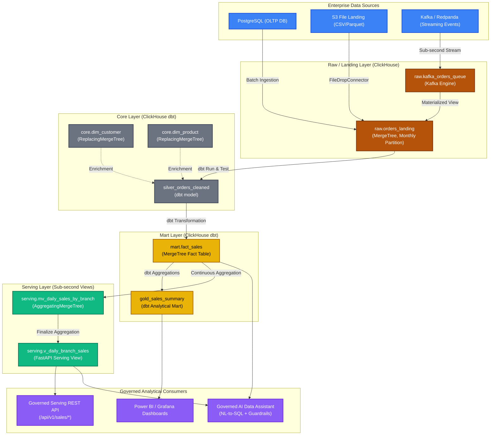

# Enterprise Data Lakehouse - Data Catalog & Lineage (M08)

> **Document:** Data Catalog & Governance Dictionary | Enterprise Data Lakehouse Platform
> **Generated Baseline:** 2026-09-04 04:51:03 UTC | **Target Engine:** ClickHouse 26.8 LTS | **Governance:** `AGENTS.md`

---

## 1. End-to-End Interactive Data Lineage

---

## 2. Table Summary & Governance Metadata

| Table Identifier | Layer | Engine | Update Frequency / SLA | Retention Policy | Sensitivity |
| :--- | :--- | :--- | :--- | :--- | :--- |
| [`core.dim_customer`](#core-dim_customer) | Silver / Core | `ReplacingMergeTree(_source_updated_at, _is_deleted)` | Hourly | Indefinite (Master Entity) | `RESTRICTED (PII)` |
| [`core.dim_product`](#core-dim_product) | Silver / Core | `ReplacingMergeTree(_source_updated_at, _is_deleted)` | Hourly | Indefinite (Master Entity) | `INTERNAL` |
| [`mart.ext_s3_sales_archive`](#mart-ext_s3_sales_archive) | Standard Table | `MergeTree` | Daily Batch | Standard NVMe | `CONFIDENTIAL` |
| [`mart.fact_sales`](#mart-fact_sales) | Gold / Mart | `MergeTree` | Daily / Hourly | 365 days Hot -> S3 Cold Tier | `CONFIDENTIAL` |
| [`raw.ext_iceberg_orders`](#raw-ext_iceberg_orders) | Standard Table | `MergeTree` | Daily Batch | Standard NVMe | `CONFIDENTIAL` |
| [`raw.ext_s3_orders_landing`](#raw-ext_s3_orders_landing) | Standard Table | `MergeTree` | Daily Batch | Standard NVMe | `CONFIDENTIAL` |
| [`raw.kafka_orders_queue`](#raw-kafka_orders_queue) | Bronze / Streaming Buffer | `Kafka` | Sub-second (< 1s) | Ephemeral in-memory consumer queue | `CONFIDENTIAL` |
| [`raw.orders_landing`](#raw-orders_landing) | Bronze / Raw | `MergeTree` | Near Real-Time (< 5 min) / Batch Hourly | 30 days Hot NVMe -> Cold S3 Storage via Storage Policy | `CONFIDENTIAL` |
| [`serving.daily_branch_sales_mv_target`](#serving-daily_branch_sales_mv_target) | Standard Table | `MergeTree` | Daily Batch | Standard NVMe | `CONFIDENTIAL` |
| [`serving.mv_daily_sales_by_branch`](#serving-mv_daily_sales_by_branch) | Serving / Gold Aggregates | `AggregatingMergeTree` | Sub-second materialized updates | Aligned with fact_sales | `INTERNAL` |
| [`serving.v_daily_branch_sales`](#serving-v_daily_branch_sales) | Serving / Presentation | `View` | Sub-second (< 100ms API response) | Virtual (Computed on-the-fly) | `INTERNAL` |

---

## 3. Data Dictionary & Column Specifications

### `core.dim_customer`

- **Description:** Cleaned, conformed customer dimension table with CDC deduplication via ReplacingMergeTree.
- **Layer:** Silver / Core
- **Table Engine:** `ReplacingMergeTree(_source_updated_at, _is_deleted)`
- **Sorting / Primary Key:** `(customer_id)`
- **Upstream Source:** CRM / Master DB

| Column Name | ClickHouse Data Type | Classification | Technical Notes |
| :--- | :--- | :--- | :--- |
| `customer_id` | `UInt64` | `INTERNAL` | Primary key / identifier |
| `customer_code` | `String` | `INTERNAL` | - |
| `customer_name` | `String` | `RESTRICTED (PII)` | - |
| `customer_segment` | `LowCardinality(String)` | `INTERNAL` | - |
| `region` | `LowCardinality(String)` | `INTERNAL` | - |
| `country` | `LowCardinality(String)` | `INTERNAL` | - |
| `credit_limit` | `Decimal(18` | `CONFIDENTIAL` | - |
| `is_active` | `UInt8` | `INTERNAL` | - |
| `_source_system` | `LowCardinality(String)` | `SYSTEM METADATA` | Technical ingestion tracking |
| `_source_table` | `LowCardinality(String)` | `SYSTEM METADATA` | Technical ingestion tracking |
| `_ingested_at` | `DateTime64(3)` | `SYSTEM METADATA` | Technical ingestion tracking |
| `_source_updated_at` | `DateTime64(3)` | `SYSTEM METADATA` | Technical ingestion tracking |
| `_batch_id` | `String` | `SYSTEM METADATA` | Technical ingestion tracking |
| `_record_hash` | `FixedString(32)` | `SYSTEM METADATA` | Technical ingestion tracking |
| `_is_deleted` | `UInt8` | `SYSTEM METADATA` | Technical ingestion tracking |

### `core.dim_product`

- **Description:** Product catalog dimension table containing categories, unit costs, and active status.
- **Layer:** Silver / Core
- **Table Engine:** `ReplacingMergeTree(_source_updated_at, _is_deleted)`
- **Sorting / Primary Key:** `(product_id)`
- **Upstream Source:** ERP / Product Catalog

| Column Name | ClickHouse Data Type | Classification | Technical Notes |
| :--- | :--- | :--- | :--- |
| `product_id` | `UInt64` | `INTERNAL` | Primary key / identifier |
| `product_sku` | `String` | `INTERNAL` | - |
| `product_name` | `String` | `INTERNAL` | - |
| `category` | `LowCardinality(String)` | `INTERNAL` | - |
| `brand` | `LowCardinality(String)` | `INTERNAL` | - |
| `unit_cost` | `Decimal(18` | `INTERNAL` | - |
| `base_price` | `Decimal(18` | `INTERNAL` | - |
| `_source_system` | `LowCardinality(String)` | `SYSTEM METADATA` | Technical ingestion tracking |
| `_source_table` | `LowCardinality(String)` | `SYSTEM METADATA` | Technical ingestion tracking |
| `_ingested_at` | `DateTime64(3)` | `SYSTEM METADATA` | Technical ingestion tracking |
| `_source_updated_at` | `DateTime64(3)` | `SYSTEM METADATA` | Technical ingestion tracking |
| `_batch_id` | `String` | `SYSTEM METADATA` | Technical ingestion tracking |
| `_record_hash` | `FixedString(32)` | `SYSTEM METADATA` | Technical ingestion tracking |
| `_is_deleted` | `UInt8` | `SYSTEM METADATA` | Technical ingestion tracking |

### `mart.ext_s3_sales_archive`

- **Description:** Table definition in Medallion architecture.
- **Layer:** Core Layer
- **Table Engine:** `MergeTree`

| Column Name | ClickHouse Data Type | Classification | Technical Notes |
| :--- | :--- | :--- | :--- |
| `order_id` | `UInt64` | `INTERNAL` | Primary key / identifier |
| `order_timestamp` | `DateTime64(3)` | `INTERNAL` | - |
| `branch_id` | `UInt32` | `INTERNAL` | Primary key / identifier |
| `customer_id` | `UInt64` | `INTERNAL` | Primary key / identifier |
| `product_id` | `UInt64` | `INTERNAL` | Primary key / identifier |
| `unit_price` | `Decimal(18` | `CONFIDENTIAL` | - |
| `quantity` | `Decimal(18` | `INTERNAL` | - |
| `discount` | `Decimal(18` | `CONFIDENTIAL` | - |
| `net_amount` | `Decimal(18` | `CONFIDENTIAL` | - |
| `status` | `LowCardinality(String)` | `INTERNAL` | - |
| `_source_system` | `LowCardinality(String)` | `SYSTEM METADATA` | Technical ingestion tracking |
| `_ingested_at` | `DateTime64(3)` | `SYSTEM METADATA` | Technical ingestion tracking |

### `mart.fact_sales`

- **Description:** Business transactional sales fact table with foreign keys, net revenues, and partitioned monthly.
- **Layer:** Gold / Mart
- **Table Engine:** `MergeTree`
- **Partition Key:** `toYYYYMM(order_timestamp)`
- **Sorting / Primary Key:** `(order_timestamp, branch_id, customer_id, order_id)`
- **Upstream Source:** dbt Transformation (silver_orders_cleaned + dim_customer + dim_product)

| Column Name | ClickHouse Data Type | Classification | Technical Notes |
| :--- | :--- | :--- | :--- |
| `sale_date` | `Date` | `INTERNAL` | - |
| `sale_datetime` | `DateTime64(3)` | `INTERNAL` | - |
| `order_id` | `UInt64` | `INTERNAL` | Primary key / identifier |
| `customer_id` | `UInt64` | `INTERNAL` | Primary key / identifier |
| `product_id` | `UInt64` | `INTERNAL` | Primary key / identifier |
| `branch_id` | `UInt32` | `INTERNAL` | Primary key / identifier |
| `quantity` | `Decimal(18` | `INTERNAL` | - |
| `unit_price` | `Decimal(18` | `CONFIDENTIAL` | - |
| `discount_amount` | `Decimal(18` | `CONFIDENTIAL` | - |
| `amount` | `Decimal(18` | `INTERNAL` | - |
| `_source_system` | `LowCardinality(String)` | `SYSTEM METADATA` | Technical ingestion tracking |
| `_ingested_at` | `DateTime64(3)` | `SYSTEM METADATA` | Technical ingestion tracking |

### `raw.ext_iceberg_orders`

- **Description:** Table definition in Medallion architecture.
- **Layer:** Core Layer
- **Table Engine:** `MergeTree`

| Column Name | ClickHouse Data Type | Classification | Technical Notes |
| :--- | :--- | :--- | :--- |
| `order_id` | `UInt64` | `INTERNAL` | Primary key / identifier |
| `customer_id` | `UInt64` | `INTERNAL` | Primary key / identifier |
| `order_timestamp` | `DateTime64(3)` | `INTERNAL` | - |
| `branch_id` | `UInt32` | `INTERNAL` | Primary key / identifier |
| `product_id` | `UInt64` | `INTERNAL` | Primary key / identifier |
| `unit_price` | `Decimal(18` | `CONFIDENTIAL` | - |
| `quantity` | `Decimal(18` | `INTERNAL` | - |
| `status` | `String` | `INTERNAL` | - |

### `raw.ext_s3_orders_landing`

- **Description:** Table definition in Medallion architecture.
- **Layer:** Core Layer
- **Table Engine:** `MergeTree`

| Column Name | ClickHouse Data Type | Classification | Technical Notes |
| :--- | :--- | :--- | :--- |
| `order_id` | `UInt64` | `INTERNAL` | Primary key / identifier |
| `customer_id` | `UInt64` | `INTERNAL` | Primary key / identifier |
| `order_timestamp` | `DateTime64(3)` | `INTERNAL` | - |
| `branch_id` | `UInt32` | `INTERNAL` | Primary key / identifier |
| `product_id` | `UInt64` | `INTERNAL` | Primary key / identifier |
| `unit_price` | `Decimal(18` | `CONFIDENTIAL` | - |
| `quantity` | `Decimal(18` | `INTERNAL` | - |
| `discount` | `Decimal(18` | `CONFIDENTIAL` | - |
| `status` | `LowCardinality(String)` | `INTERNAL` | - |
| `raw_payload` | `String` | `INTERNAL` | - |
| `_source_system` | `LowCardinality(String)` | `SYSTEM METADATA` | Technical ingestion tracking |
| `_source_table` | `LowCardinality(String)` | `SYSTEM METADATA` | Technical ingestion tracking |
| `_ingested_at` | `DateTime64(3)` | `SYSTEM METADATA` | Technical ingestion tracking |
| `_source_updated_at` | `DateTime64(3)` | `SYSTEM METADATA` | Technical ingestion tracking |
| `_batch_id` | `String` | `SYSTEM METADATA` | Technical ingestion tracking |
| `_record_hash` | `String` | `SYSTEM METADATA` | Technical ingestion tracking |
| `_is_deleted` | `UInt8` | `SYSTEM METADATA` | Technical ingestion tracking |

### `raw.kafka_orders_queue`

- **Description:** Buffer queue engine consuming JSON messages from Redpanda/Kafka topic enterprise.orders.events.
- **Layer:** Bronze / Streaming Buffer
- **Table Engine:** `Kafka`
- **Upstream Source:** Kafka / Redpanda Topic: enterprise.orders.events

| Column Name | ClickHouse Data Type | Classification | Technical Notes |
| :--- | :--- | :--- | :--- |
| `order_id` | `UInt64` | `INTERNAL` | Primary key / identifier |
| `customer_id` | `UInt64` | `INTERNAL` | Primary key / identifier |
| `order_timestamp` | `String` | `INTERNAL` | - |
| `branch_id` | `UInt32` | `INTERNAL` | Primary key / identifier |
| `product_id` | `UInt64` | `INTERNAL` | Primary key / identifier |
| `unit_price` | `Decimal(18` | `CONFIDENTIAL` | - |
| `quantity` | `Decimal(18` | `INTERNAL` | - |
| `discount` | `Decimal(18` | `CONFIDENTIAL` | - |
| `status` | `String` | `INTERNAL` | - |

### `raw.orders_landing`

- **Description:** Append-only bronze landing table capturing raw e-commerce and POS transactions with 7 technical metadata columns.
- **Layer:** Bronze / Raw
- **Table Engine:** `MergeTree`
- **Partition Key:** `toYYYYMM(order_timestamp)`
- **Sorting / Primary Key:** `(order_timestamp, branch_id, order_id)`
- **Upstream Source:** PostgreSQL, S3 File Drop, Kafka Event Stream

| Column Name | ClickHouse Data Type | Classification | Technical Notes |
| :--- | :--- | :--- | :--- |
| `order_id` | `UInt64` | `INTERNAL` | Primary key / identifier |
| `customer_id` | `UInt64` | `INTERNAL` | Primary key / identifier |
| `order_timestamp` | `DateTime64(3)` | `INTERNAL` | - |
| `branch_id` | `UInt32` | `INTERNAL` | Primary key / identifier |
| `product_id` | `UInt64` | `INTERNAL` | Primary key / identifier |
| `unit_price` | `Decimal(18` | `CONFIDENTIAL` | - |
| `quantity` | `Decimal(18` | `INTERNAL` | - |
| `discount` | `Decimal(18` | `CONFIDENTIAL` | - |
| `status` | `LowCardinality(String)` | `INTERNAL` | - |
| `raw_payload` | `String` | `INTERNAL` | - |
| `_source_system` | `LowCardinality(String)` | `SYSTEM METADATA` | Technical ingestion tracking |
| `_source_table` | `LowCardinality(String)` | `SYSTEM METADATA` | Technical ingestion tracking |
| `_ingested_at` | `DateTime64(3)` | `SYSTEM METADATA` | Technical ingestion tracking |
| `_source_updated_at` | `DateTime64(3)` | `SYSTEM METADATA` | Technical ingestion tracking |
| `_batch_id` | `String` | `SYSTEM METADATA` | Technical ingestion tracking |
| `_record_hash` | `FixedString(32)` | `SYSTEM METADATA` | Technical ingestion tracking |
| `_is_deleted` | `UInt8` | `SYSTEM METADATA` | Technical ingestion tracking |

### `serving.daily_branch_sales_mv_target`

- **Description:** Table definition in Medallion architecture.
- **Layer:** Core Layer
- **Table Engine:** `MergeTree`

| Column Name | ClickHouse Data Type | Classification | Technical Notes |
| :--- | :--- | :--- | :--- |
| `sale_date` | `Date` | `INTERNAL` | - |
| `branch_id` | `UInt32` | `INTERNAL` | Primary key / identifier |
| `total_orders` | `AggregateFunction(count` | `INTERNAL` | - |
| `total_quantity` | `AggregateFunction(sum` | `INTERNAL` | - |
| `total_revenue` | `AggregateFunction(sum` | `CONFIDENTIAL` | - |
| `unique_customers` | `AggregateFunction(uniqExact` | `INTERNAL` | - |

### `serving.mv_daily_sales_by_branch`

- **Description:** AggregatingMergeTree materialized view pre-computing daily revenue and order counts per branch.
- **Layer:** Serving / Gold Aggregates
- **Table Engine:** `AggregatingMergeTree`
- **Partition Key:** `toYYYYMM(sales_date)`
- **Sorting / Primary Key:** `(sales_date, branch_id)`
- **Upstream Source:** Continuous aggregation on mart.fact_sales

*Columns dynamically resolved via dbt models.*

### `serving.v_daily_branch_sales`

- **Description:** Consumable serving view querying mv_daily_sales_by_branch with finalizeAggregation() for sub-second REST API queries.
- **Layer:** Serving / Presentation
- **Table Engine:** `View`
- **Upstream Source:** serving.mv_daily_sales_by_branch

*Columns dynamically resolved via dbt models.*

---

## 4. Data Governance & Security Controls

- **Technical Metadata Standard**: Every record in `raw` and `core` MUST carry the 7 canonical metadata attributes (`_source_system`, `_source_table`, `_ingested_at`, `_source_updated_at`, `_batch_id`, `_record_hash`, `_is_deleted`).
- **PII Protection**: Columns classified as `RESTRICTED (PII)` must not be queried by analytical service accounts or exposed through unauthenticated APIs.
- **Zero-Trust Role Enforcement**: Data analysts and BI tools connect via `role_bi_readonly` restricting access exclusively to `mart` and `serving` databases.
