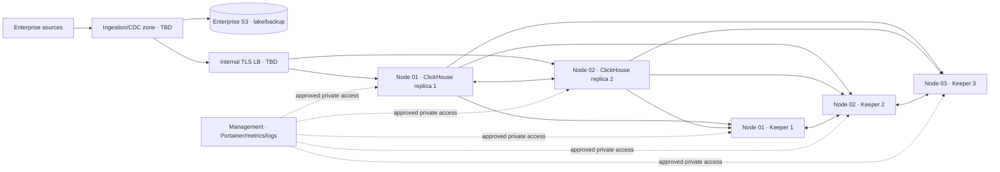

# คู่มือติดตั้งและใช้งาน Production แบบทีละโหนด

**Enterprise Data Lakehouse Platform · ฉบับเตรียมติดตั้ง 2026-11-02**  
**สถานะ repository: NOT READY FOR PRODUCTION.** เอกสารนี้เป็นขั้นตอนปฏิบัติและเกณฑ์ตรวจรับสำหรับ target architecture; ยังไม่มีผลทดสอบ production หรือสิทธิ์ให้ agent deploy. ใช้ร่วมกับ [นโยบาย](../AGENTS.md), [Production architecture](architecture/PROD_ARCHITECTURE.md), [production runbook](../runbooks/04_portainer_prod_deployment.md) และ [รายการ P0/P1](PRODUCTION_READINESS_SPECIALIST_WORKLIST.md). หากข้อใดเป็น `TBD` หรือ gate ไม่ผ่าน ให้หยุดที่ขั้นนั้น.

## 1. ขอบเขตและผลลัพธ์ที่ต้องได้

เป้าหมายคือ ClickHouse **1 shard × 2 replicated data nodes** และ Keeper **3 members** บน **3 independent failure domains**, มี management zone แยก, enterprise S3 สำหรับ lake/backup, ingestion zone และ internal TLS load balancer. UAT host เดียวใช้แทนผลทดสอบ HA ไม่ได้. การเห็น stack ใน Portainer, `/ping` ผ่าน หรือ Compose parse ผ่าน ไม่ได้พิสูจน์ replication, data correctness, DR, security หรือ end-to-end readiness.



| โหนด/zone | ระบบและ Portainer environment | ความรับผิดชอบ |
| --- | --- | --- |
| Node 01 / failure domain 1 | Keeper 01, ClickHouse 01 / `prod-node1` | replica แรก, Keeper member 1 |
| Node 02 / failure domain 2 | Keeper 02, ClickHouse 02 / `prod-node2` | replica ที่สอง, Keeper member 2 |
| Node 03 / failure domain 3 | Keeper 03 / `prod-keeper3` | quorum tie-breaker; ไม่มี ClickHouse data replica |
| Management zone | Portainer Server, Prometheus, Grafana, Loki / `prod-management` | แยกจากสาม failure domains; Compose production ยัง `TBD` |
| Ingestion/consumer/object storage zones | source workers, internal LB, enterprise S3 | ระบบภายนอก cluster; topology/owner/endpoint `TBD` |

## 2. สิ่งที่องค์กรต้องกำหนดก่อนเริ่ม

| หมวด | ค่าหรือหลักฐานที่ต้องอนุมัติ |
| --- | --- |
| Host/network | IP, DNS/FQDN, subnet/CIDR, failure-domain mapping, route, firewall source allowlist, management VPN, NTP/DNS resolvers = `TBD` |
| Sizing | CPU/RAM/NVMe/IOPS/usable capacity ของ Node 01–03 จาก ingest rate, retention, query concurrency, merge/backup headroom และ load test = `TBD`; ค่า `16 CPU/64G` ใน Compose เป็น limit ตั้งต้น ไม่ใช่ sizing ที่ผ่านรับรอง |
| Software | Ubuntu 24 LTS, Docker Engine + Compose V2, approved ClickHouse/Keeper **26.8 patch + immutable digest**, Portainer/Agent digest, registry trust, vulnerability-scan result |
| Data/DR | source owner, data classification, retention, KPI/quality thresholds, enterprise S3 bucket/region/KMS, backup scope, RPO/RTO ที่ business owner ลงนาม = `TBD` |
| Security | secret manager, TLS certificate/CA, authentication and service roles, audit log, approved LB health policy, change record/CAB |

**ห้ามนำ `.env.example` มาใช้กับ PROD:** ไฟล์นั้นตั้งค่า DEV/UAT รวมถึง sample IP และ sample credentials. จัดค่า production ใน approved secret mechanism ขององค์กร; อย่า commit, พิมพ์ secret ใน log หรือแนบผล `docker compose config` ที่ขยายค่า secret แล้ว. ทุก node ต้องใช้ approved Git tag/SHA และ image digest ชุดเดียวกัน.

### Host baseline (ผู้ดูแลระบบรันบน Ubuntu 24 LTS ทั้งสามโหนด)

1. ยืนยันแยก failure domain จริง, storage และ backup ของ host, hardened OS, patch level, time sync, DNS, registry access และ Docker/Compose ตามมาตรฐานองค์กร. ติดตั้งผ่าน approved package repository; บันทึก `lsb_release -a`, `docker version`, `docker compose version`, `timedatectl status`, `df -h`, `lsblk` โดยตัดข้อมูล sensitive ออกจากรายงาน.
2. เตรียม filesystem/volume สำหรับ ClickHouse data/log และ Keeper data แยกตาม sizing ที่อนุมัติ; กำหนด owner, mount persistence, free-space alert และ lifecycle. ห้ามใช้ Docker volume เดียวกันข้ามโหนดหรือถือว่า named volume เป็น backup.
3. ยืนยัน DNS/`/etc/hosts` ที่ approved สำหรับ `keeper-01..03` และ `clickhouse-01..02` จาก **ทุก** โหนด. `HOST_NODE*_IP` ต้องเป็น IP จริงที่อนุมัติ; Compose production บังคับให้ระบุค่าและไม่มี `127.0.0.1` fallback แล้ว.
4. เตรียม private interface และ firewall ตามตารางด้านล่างก่อนเผยแพร่พอร์ต. Compose production ผูก published ports กับ `HOST_NODE*_IP`; ต้องตรวจว่าเป็น private interface ที่อนุมัติจริงและ firewall จำกัด source. Docker publish แบบไม่ระบุ host IP จะผูกกับทุก interface โดยปริยาย. อ้างอิง [Docker port publishing](https://docs.docker.com/engine/network/port-publishing/).

## 3. สถาปัตยกรรมเครือข่ายและ Published Ports

Bridge networks ใน Compose (`data_backend`, `data_storage`, `observability`, `management`) เป็น **เครือข่ายภายในแต่ละ host**. ชื่อ network เดียวกันบนคนละ host ไม่ได้เชื่อมต่อกันเอง; east-west traffic ข้าม host ใช้ host IP/DNS และ published ports หรือ network overlay ที่ออกแบบและทดสอบแยก. Inbound ทุกเส้นต้องมี source CIDR ที่อนุมัติ; **ไม่มีพอร์ตใดเปิดสู่ Internet**.

| Destination / process | Container TCP | Published ใน Compose production | Source ที่อนุมัติเท่านั้น | หมายเหตุ/เป้าหมาย |
| --- | ---: | --- | --- | --- |
| Node 01–03 Keeper client | 9181 | `${HOST_NODE*_IP}:9181:9181` | ClickHouse 01/02; trusted admin/monitoring ตามหน้าที่ | private backend IP; ไม่ใช่พอร์ตผู้ใช้ |
| Node 01–03 Keeper Raft | 9234 | `${HOST_NODE*_IP}:9234:9234` | Keeper 01–03 | private east-west เท่านั้น |
| Node 01–02 ClickHouse interserver | 9009 | `${HOST_NODE*_IP}:9009:9009` | ClickHouse 01/02 | ตรวจ replication traffic และ TLS design |
| Node 01–02 ClickHouse Native | 9000 | `${HOST_NODE*_IP}:9000:9000` | trusted ingestion/BI หรือ internal LB | endpoint ผู้ใช้ควรผ่าน policy/TLS ที่อนุมัติ |
| Node 01–02 ClickHouse HTTP | 8123 | `${HOST_NODE*_IP}:8123:8123` | internal LB/API/ingestion | ใช้ TLS proxy/LB ที่อนุมัติ; ไม่เปิดตรงแก่ Internet |
| Node 01–02 ClickHouse metrics | 9363 | `${HOST_NODE*_IP}:9363:9363` | Prometheus ใน management zone | verify exporter and scrape target จริง |
| Node 01–03 Portainer Agent | 9001 | `${HOST_NODE*_IP}:9001:9001` เฉพาะ profile `agent` | Portainer Server เท่านั้น | profile ปิดโดยปริยาย; อย่าเปิดซ้ำถ้ามี agent managed แยก |
| Management Portainer UI | 9443 | ยังไม่มี PROD Compose ใน repo | management VPN/admin | Portainer Server อยู่นอก data hosts |
| ClickHouse → enterprise S3 | 443 outbound | ไม่ต้อง publish | enterprise S3 endpoint | HTTPS, CA/KMS/endpoint ที่อนุมัติ |

`ports:` ถูกปรับให้ต้องระบุ host IP แล้ว แต่ Compose ไม่ยืนยันว่า IP นั้นเป็น private/approved. ตรวจผลจริงด้วย `docker compose ... config` (เก็บแบบ redacted), `docker ps --format` และ `ss -lnt` บนแต่ละ host; ตรวจจาก source ที่อนุญาตและ source ที่ **ไม่ได้** อนุญาต. อย่าคิดว่า UFW rule เพียงอย่างเดียวครอบคลุม Docker NAT; ให้ Network/Security owner ทดสอบเส้นทางจริง. [Docker documentation](https://docs.docker.com/engine/network/port-publishing/) ระบุผลของ published port ชัดเจน.

## 4. Gate ที่ต้องปิดก่อนใช้ Compose ชุดนี้กับ production

### ผลกระทบของการปรับ Compose ในรอบนี้

การเปลี่ยนแปลงจำกัดที่ไฟล์ production 3 โหนด; UAT Compose และ SQL ไม่เปลี่ยน. Stack เก่าที่ไม่ได้ส่ง `KEEPER_PROD_IMAGE`, `CLICKHOUSE_PROD_IMAGE`, `PORTAINER_AGENT_PROD_IMAGE` และ `HOST_NODE*_IP` จะ **parse ไม่ผ่าน** จนกว่าจะตั้งค่าที่อนุมัติ. Published Ports จะรับบน IP ที่ระบุเท่านั้น จึงต้องตรวจว่า Portainer, peer nodes, LB และ Prometheus เข้าถึงได้ตาม allowlist. ไม่มีการเปลี่ยนชื่อ Docker volumes หรือ migration ของข้อมูลในรอบนี้; **storage impact ของ Compose edit เป็นศูนย์ในระดับ schema/volume definition** แต่การ redeploy container จริงอาจกระทบ availability และต้องมี change window. การย้อนกลับ YAML จะคืนการ bind แบบกว้าง/ค่า fallback ที่ไม่ปลอดภัย จึงต้องใช้ reviewed release และ network rollback plan; ห้าม rollback ด้วยการลบ volumes.

| Gate | สถานะจาก repository | หลักฐานที่จะปลด gate |
| --- | --- | --- |
| Replication/DDL | [SQL init](../sql/init/02_medallion_tables.sql) ใช้ local `MergeTree`/`ReplacingMergeTree`; [serving target](../sql/init/03_materialized_views.sql) ใช้ `AggregatingMergeTree` และไม่มี `ON CLUSTER` | reviewed replicated-table/DDL design, isolated migration/backfill, parser result, `system.replicas`/queue, checksum parity และ host-loss test |
| Staged Git stacks | [node 1](../compose/docker-compose.prod-node1.yml)/[node 2](../compose/docker-compose.prod-node2.yml) รวม Keeper+ClickHouse; Portainer Git stack deploy ปกติจะสร้างทั้งคู่ | approved Keeper-only และ ClickHouse-only Git-backed stacks/controlled profiles, service/network ownership, dry-run และ rollback; ห้ามแก้ ad hoc ใน Portainer editor |
| Immutable/reproducible deployment | Compose บังคับ `KEEPER_PROD_IMAGE`, `CLICKHOUSE_PROD_IMAGE`, `PORTAINER_AGENT_PROD_IMAGE` และ `HOST_NODE*_IP` แล้ว แต่ไม่ได้ตรวจว่า image value เป็น digest จริง; relative config/SQL bind mounts ยังอยู่ | approved patch/digest และ scan result, immutable config image หรือ approved absolute paths, ตรวจ IP/source allowlist และ required env ที่เหลือ |
| Process config | `keeper_config.xml` ถูก mount ใน Keeper และเป็นส่วนหนึ่งของ `config.d` ของ ClickHouse | ตรวจว่า Keeper process/server config ไม่ชน server ID, config parser ผ่าน, quorum และ zookeeper connectivity ผ่าน |
| Service/data completeness | production ingestion/CDC, management observability, LB/TLS, S3/KMS และ dbt runtime ยัง `TBD` | approved configs, integration tests, access tests, source→S3→raw→core→mart→serving reconciliation |
| Recovery | [backup/restore scripts](../scripts/) ยังไม่พิสูจน์ full-scope DR | independent object backup, isolated restore drill, schema/count/hash reconciliation, measured approved RPO/RTO |

Portainer รองรับ relative paths สำหรับ Git stacks แต่มีเงื่อนไขการ mount/redeploy; จึงต้องออกแบบ immutable config/absolute host paths และทดสอบ lifecycle ก่อนใช้จริง ([Portainer relative paths](https://docs.portainer.io/advanced/relative-paths), [update caveat](https://docs.portainer.io/sts/faqs/troubleshooting/stacks-deployments-and-updates/empty-relative-bind-mounts)). จนกว่า gate เหล่านี้จะผ่าน คู่มือด้านล่างเป็น **ลำดับติดตั้งและตรวจรับที่เสนอ** ไม่ใช่คำสั่งให้ deploy Compose ปัจจุบัน.

## 5. ลำดับติดตั้งและตรวจรับทีละโหนด

### Phase 0 — Management และ artifact approval

1. Platform owner ติดตั้ง Portainer Server ใน management zone ผ่านวิธีที่องค์กรอนุมัติ; จำกัด UI `9443/TCP` ให้ VPN, เปิด SSO/MFA/RBAC/audit/backup ของ Portainer data. PROD management Compose ยัง `TBD`.
2. อนุมัติ Git release tag/SHA, registry image digests, signed scan results, config/secret delivery, network matrix, rollback record และแยก Portainer environments `prod-keeper3`, `prod-node1`, `prod-node2`.
3. แยก Git-backed Keeper/ClickHouse stages หรือวิธี controlled profile ที่พิสูจน์แล้ว. Verify `docker compose config --quiet` ทุก stage ใน isolated validation workspace. ห้ามใช้ full node stack ปัจจุบันเพื่อ bootstrap Keeper แบบทีละบริการผ่าน Portainer โดยไม่มี stage design.

### Phase 1 — Node 03: Keeper 03

1. ยืนยัน host 03, DNS `keeper-01..03`, private IP, image/config digest, persistent volume และ 9181/9234 inbound ตาม allowlist. ไม่มี ClickHouse service บน host นี้.
2. Deploy **approved Git-backed Keeper-only stage** ไป `prod-keeper3`; ตรวจ `docker ps`/health/log แบบตัด secret. สมาชิกเดียว **ยังไม่เป็น quorum**; สถานะ pending peer เป็น expected ระหว่าง bootstrap.
3. ตรวจ local port/bind IP และ DNS/route ไป Node 01/02. หยุดหาก image, config หรือ published port ไม่ตรง release.

### Phase 2 — Node 01: Keeper 01

1. ยืนยัน host 01 ใช้ `KEEPER_SERVER_ID=1`, private IP ที่ approved, volume เฉพาะ node และ peer endpoints 9234 ไป Node 02/03.
2. Deploy **approved Keeper-only stage** ไป `prod-node1`; ตรวจ container/config/port และ log. สองสมาชิกอาจเริ่ม quorum ได้ แต่ยังต้องเพิ่ม member 3 ตาม topology; ห้ามเปิด ClickHouse traffic.

### Phase 3 — Node 02: Keeper 02 และ quorum gate

1. ยืนยัน host 02 ใช้ `KEEPER_SERVER_ID=2` และ network/storage ตาม phase ก่อนหน้า; deploy approved Keeper-only stage ไป `prod-node2`.
2. จาก trusted admin path ตรวจ member ทั้งสาม เช่น `echo ruok | nc <NODE_IP> 9181` และ `echo stat | nc <NODE_IP> 9181` **เมื่อคำสั่งนี้เปิดใช้ใน config ที่อนุมัติ**; ตรวจ leader/follower/quorum, peer connectivity และ restart test แบบไม่ลบ volume. บันทึก output จริง. ดู [ClickHouse Keeper commands](https://presentations.clickhouse.com/2021-release-21.12/).
3. หยุดหากมี member ID ซ้ำ, DNS ผิด, quorum ไม่ครบ หรือ Raft port เปิดกว้างกว่าที่อนุมัติ.

### Phase 4 — Node 01: ClickHouse replica 01

1. หลัง P0 replication/DDL และ config gates ผ่าน จึง deploy **approved ClickHouse-only stage** บน Node 01 โดยใช้ `CLICKHOUSE_SHARD=1`, `CLICKHOUSE_REPLICA=1`, service credentials/S3 config จาก secret manager และ image digest ที่อนุมัติ.
2. ตรวจ server process, config loaded, Keeper session, `system.clusters`, `system.databases`, table engines ใน `system.tables`, storage policy/S3 access และ init SQL result. `/ping` ใช้ตรวจ process เท่านั้น.
3. ยืนยัน HTTP/native/metrics/interserver bind บน private IP; ยังไม่เปิด LB/BI/ingestion traffic.

### Phase 5 — Node 02: ClickHouse replica 02

1. Deploy approved stage บน Node 02 ด้วย `CLICKHOUSE_SHARD=1`, `CLICKHOUSE_REPLICA=2`; replica ต้องใช้ Keeper path เดียวกันและ replica name ต่างกัน.
2. ตรวจ table inventory/DDL ทั้งสอง node, `system.replicas`, `system.replication_queue`, data counts/checksums และ query ผลเดียวกัน. ทดสอบ insert/update/delete/replay เฉพาะ fixture ที่อนุมัติใน isolated environment.
3. ทดสอบ Node 01 loss/rejoin และ Node 02 loss/rejoin ตาม change plan; ตรวจว่า reads/writes, quorum, replication lag และ rollback เป็นไปตามเกณฑ์. **ยังไม่อ้าง HA** หากไม่ได้ทดสอบข้าม failure domains จริง.

### Phase 6 — Data path, observability, recovery และ traffic

1. Data Owner/Platform นำ ingestion/CDC, contract validation, dbt runtime และ data-quality role ที่อนุมัติมาต่อจาก source จริง. ตรวจ source→S3 object→raw→core→mart→serving ด้วย lineage, counts, amounts, hash, retries/replay และ negative cases.
2. SRE เปิด production Prometheus/Grafana/Loki ใน management zone พร้อม log shipper, alert routing และ dashboard ที่ตรวจ target จริง. ทดสอบ alert delivery และ runbook.
3. Backup ไป independent S3 แล้วทำ **non-destructive restore drill** ใน isolated namespace; ตรวจ inventory, counts, hashes, query result และเวลาที่ใช้เทียบ RPO/RTO ซึ่ง business owner ลงนาม. ห้ามใช้การมี backup file เป็นหลักฐาน DR.
4. Security/API owner ตรวจ API auth, RBAC, TLS, CORS, least privilege และ scan; Network owner ตั้ง internal LB/VIP เฉพาะ healthy replicas. เริ่ม canary และตรวจ latency/error/lag ก่อน full traffic ตาม CAB approval.

## 6. คำสั่งตรวจใน validation workspace (ยังไม่ใช่คำสั่ง deploy)

รันบน approved release checkout ที่ไม่มี secret จริง และบันทึก exit code/output แบบ redacted. `<APPROVED_ENV_FILE>` เป็นไฟล์ชั่วคราวในพื้นที่ควบคุมซึ่ง **ไม่ commit**; การใช้ placeholder เพื่อตรวจ syntax ไม่ใช่หลักฐาน connectivity.

```bash
docker compose --env-file <APPROVED_ENV_FILE> -f compose/docker-compose.prod-keeper3.yml config --quiet
docker compose --env-file <APPROVED_ENV_FILE> -f compose/docker-compose.prod-node1.yml config --quiet
docker compose --env-file <APPROVED_ENV_FILE> -f compose/docker-compose.prod-node2.yml config --quiet
python3 governance/policy_linter.py
```

หลังมี isolated cluster ที่อนุมัติ จึงเก็บผล read-only checks เช่น:

```sql
SELECT cluster, shard_num, replica_num, host_name, port FROM system.clusters WHERE cluster = 'cluster_1s_2r';
SELECT database, name, engine FROM system.tables WHERE database IN ('raw','core','mart','serving') ORDER BY database, name;
SELECT database, table, is_leader, is_readonly, absolute_delay, queue_size FROM system.replicas ORDER BY database, table;
SELECT database, table, type, create_time, num_tries, last_exception FROM system.replication_queue ORDER BY database, table, create_time;
```

`system.replicas` ว่างเมื่อยังใช้ local MergeTree; นั่นเป็น **failure ของ production replication gate** แม้ SQL init และ `/ping` ผ่าน. เก็บผลจากทั้งสอง node; อย่าตีความ queue non-empty ชั่วคราวว่า fail โดยไม่มี threshold/time window ที่อนุมัติ. [ClickHouse system-table guidance](https://clickhouse.com/blog/clickhouse-debugging-issues-with-system-tables).

## 7. วิธีใช้งานและปฏิบัติการประจำวันหลังผ่าน gate

| งาน | ผู้รับผิดชอบ | ตรวจอะไร / เอกสาร |
| --- | --- | --- |
| Query/BI/API | ผู้ใช้ผ่าน internal LB และ role ที่อนุมัติ | ใช้ `mart`/`serving` ตามสิทธิ์; API endpoint ทุกตัวต้องทดสอบด้วย `api_user` จริง. ดู [Operations Manual](OPERATIONS_MANUAL.md) |
| Data load/dbt | Data Engineer | ตรวจ contract, checkpoint, batch ID, dbt run/test, source-to-serving reconciliation และ freshness |
| Health | SRE | Keeper quorum, replica lag/queue, disk/parts/merges, S3 errors, backup age, API errors, ingestion lag, alert delivery |
| Incident | On-call + domain owner | ใช้ [Troubleshooting/failover runbook](../runbooks/03_troubleshooting_and_failover.md); บันทึก change/incident, ห้ามลบ volume หรือ database เพื่อแก้เฉพาะหน้า |
| Backup/restore | Backup/SRE + Data Owner | ใช้ [backup runbook](../runbooks/02_backup_and_restore_operations.md); ทำ drill ที่แยกจาก production และรายงาน RPO/RTO จริง |
| Release/rollback | CAB/Release owner | immutable image/Git SHA, diff review, Compose/SQL checks, canary, health/data checks และ rollback limits |

## 8. เกณฑ์ “พร้อมใช้งานจริง” และ sign-off

- [ ] ทุกค่า `TBD` ที่มีผลต่อ deployment ถูกอนุมัติ; host 01–03 อยู่คนละ failure domain และ network allowlist ผ่าน negative/positive test
- [ ] Artifact ปัก patch/digest, secret/CA/volume/config ถูกส่งผ่านช่องทางที่อนุมัติ; Compose/XML/SQL parse และ security scan มีผลจริง
- [ ] Keeper 3 members มี quorum; ClickHouse 2 replicas ใช้ replicated tables จริง, parity/queue และ host-loss/rejoin test ผ่าน
- [ ] Ingestion, dbt, serving/API, role grants, data contract, reconciliation และ data quality ผ่าน test ด้วยข้อมูลและ workload ที่อนุมัติ
- [ ] Observability/alerts/log search ทำงานจริง; independent backup และ isolated restore drill พิสูจน์ RPO/RTO ที่ลงนาม
- [ ] Architecture, Data Owner, Security, Network, Platform/SRE, Business และ Release/CAB ลงนามรับ residual risks และ production promotion

## Handoff Contract

- **Scope & Sources Inspected:** PROD Compose 3 โหนด, ClickHouse/Keeper config, SQL init, architecture, production runbook, backup/restore และ AGENTS.md
- **Assumptions & Decisions:** ใช้ topology 1 shard × 2 replicas + 3 Keeper across 3 failure domains; ค่าองค์กรที่ไม่ทราบเป็น `TBD`; คู่มือนี้ยังไม่รับรอง production
- **Security & Operational Impact:** Published ports ปัจจุบัน bind กว้าง, staged Git deployment/replication/DR ยังเป็น blocker; ต้องจำกัด network, secret และ human gate
- **Validation Commands & Results:** `docker compose --env-file .env.example -f <แต่ละไฟล์ PROD> config --quiet` ผ่านทั้ง 3 ไฟล์เมื่อ inject dummy image digests/IP สำหรับ syntax preview; JSON config check ยืนยัน published ports 2/6/6 รายการผูกกับ IP ของ Node 03/01/02 ตามลำดับ; เมื่อไม่กำหนด image variables คำสั่ง fail exit 1 ตามที่ตั้งใจ. XML parser ผ่าน 8 ไฟล์, policy linter ผ่าน 9 กฎ, relative links 217 รายการไม่มีปลายทางหาย และ `git diff --check` ผ่าน. การใช้ `.env.example` เพื่อ parse ใน workspace ไม่ใช่การอนุญาตให้นำค่า UAT ไปใช้ PROD; ยังไม่มี runtime, SQL parser, network, failover หรือ restore result
- **Remaining TBDs & Residual Risks:** IP/DNS/CIDR, sizing, image digest, TLS, S3/KMS, LB, production ingestion/observability, approved RPO/RTO และผล multi-host tests
- **Human Approval Required:** ใช่ สำหรับ production promotion, firewall/credential changes, destructive migration/restore และ security exceptions
