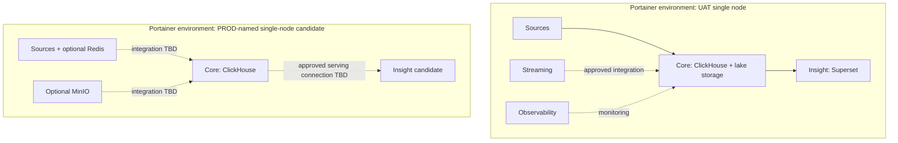

# การจัดกลุ่ม Portainer Stack — UAT และ Production Single-Node Candidate

เอกสารนี้เป็นทะเบียนและแผนจัดกลุ่มจากไฟล์ใน repository ณ 19 พฤศจิกายน 2026 **ไม่ใช่รายการ live ที่ตรวจจาก Portainer**. ดูทะเบียนที่ตรวจด้วยเครื่องได้ใน [stack-groups.single-node.json](../compose/stack-groups.single-node.json). คงชื่อ Compose, container และ volume เดิมไว้เพื่อไม่ให้การจัดกลุ่มเปลี่ยน identity ของข้อมูลโดยไม่ตั้งใจ

> **นโยบาย:** ตาม [AGENTS.md](../AGENTS.md) single-host จัดเป็น DEV/UAT สำหรับ functional testing และ benchmarking แม้ไฟล์หรือ environment จะมีชื่อ `prod`; ไม่อนุญาตให้ใช้เป็น production HA หรือเปิดรับ production traffic. Production ต้องผ่านข้อกำหนด 3 failure domains, review และ human sign-off. ดู [production gate](../runbooks/04_portainer_prod_deployment.md).

## โครงสร้างการจัดกลุ่ม

เส้นประเป็น dependency เป้าหมาย ไม่ได้ยืนยันว่ามี ingestion, integration หรือ deployment จริง. แยก UAT และ PROD-named candidate เป็นคนละ Portainer environment และคนละ host/VM ที่มี Docker daemon, secrets, networks และ storage แยกกัน. หากอยู่ Docker daemon เดียวกัน การแยกชื่อ stack อย่างเดียวไม่เพียงพอ: มี fixed `container_name`, ports และ volume/network aliases ที่อาจชนกัน. Network bridge เป็น host-local, ไม่ใช่ cross-host overlay. Portainer [Environment Groups](https://docs.portainer.io/admin/environments/groups) ใช้จัดกลุ่ม environment ทั้งชุด ไม่ใช่ folder ของ stacks ภายใน environment; ใช้ Stacks view และชื่อ stack เพื่อแสดงกลุ่มงาน ตาม [Portainer stack documentation](https://docs.portainer.io/user/docker/stacks). ชื่อด้านล่างเป็นชื่อที่เสนอสำหรับ deployment ใหม่หรือชื่อ UAT ที่คู่มือเดิมใช้ ไม่ยืนยันชื่อในระบบจริง

### UAT — functional groups

| ลำดับ | กลุ่ม / ชื่อ Portainer | Git Compose path | Services และสถานะ |
|---|---|---|---|
| 1 | Core / `lakehouse-uat-core` | [dev](../compose/docker-compose.dev.yml) | ClickHouse, MinIO + init; RustFS, dbt-runner และ serving-api เป็น optional profiles |
| 2 | Data sources / `lakehouse-uat-datasources` | [datasources](../compose/docker-compose.datasources.yml) | PostgreSQL, MySQL, SQL Server + init, MongoDB; ใช้ข้อมูล synthetic/masked |
| 3 | Streaming / `lakehouse-uat-streaming` | [streaming](../compose/docker-compose.streaming.yml) | Redpanda + Console; optional ตาม use case |
| 4 | Observability / `lakehouse-uat-observability` | [observability](../compose/docker-compose.observability.yml) | Prometheus, Grafana, Loki; ไฟล์นี้ใช้ UAT images/network แม้ชื่อ volumes ภายในมีคำว่า `prod` |
| 5 | BI / `kingpac-insight-uat` | [insight-uat](../compose/docker-compose.insight-uat.yml) | Superset, metadata PostgreSQL, Redis, init; เป็น UAT เท่านั้น |

สร้าง external networks `lakehouse-uat-integration` และ `lakehouse-uat-observability` ตามขั้นตอนที่อนุมัติใน [UAT runbook](../runbooks/01_portainer_git_stack_deployment.md) **ก่อน** deploy stacks ที่อ้างถึง; core ไม่ได้สร้าง network เหล่านี้. การติดตั้ง Grafana ClickHouse plugin ใช้ [optional overlay](../compose/docker-compose.insight-grafana-uat.yml) ภายใต้ observability stack เดิมตาม [BI UAT runbook](../runbooks/07_kingpac_insight_uat.md); ไม่ใช่ stack แยก. `uat-build` เป็น build definition ไม่ใช่ runtime stack

**Port collision:** Redpanda Console และ Superset UAT มี default host port `18088` เหมือนกัน โดย Redpanda bind ทุก interface. หากใช้ทั้งคู่บน host เดียว ให้กำหนด `INSIGHT_PORT=18089` ใน Portainer สำหรับ BI stack ใหม่หรือใน change ที่อนุมัติ และตรวจพอร์ตว่างก่อน deploy. ไม่ได้เปลี่ยนค่า default ของ stack เดิม; Superset จะอยู่ที่ `127.0.0.1:18089` และต้องใช้ trusted proxy เพื่อให้เครื่องอื่นเข้าถึง. ตรวจไฟล์ env/proxy ของจริงก่อนเปลี่ยน เพราะอาจมีผู้ใช้งานหรือ port อื่นใช้อยู่แล้ว

### PROD-named single-node — candidate groups เท่านั้น

| ลำดับ | กลุ่ม / ชื่อ Portainer ที่เสนอ | Git Compose path | Services และข้อจำกัด |
|---|---|---|---|
| 1 | Core / `lakehouse-prod-single` | [prod-single](../compose/docker-compose.prod-single.yml) | ClickHouse หนึ่ง instance; ไม่มี Keeper/quorum, replication หรือ HA |
| 2 | Data sources / `lakehouse-prod-datasources` | [prod-datasources](../compose/docker-compose.prod-datasources.yml) | PostgreSQL, MySQL, SQL Server + init, MongoDB; `insight-redis` เป็น optional profile และ single-node ไม่ใช่ Redis HA |
| 3 | Storage / `lakehouse-prod-minio` | [prod-minio](../compose/docker-compose.prod-minio.yml) | optional MinIO + init, single-host ไม่ใช่ independent backup หรือ enterprise S3 HA |
| 4 | BI / `kingpac-insight-prod` | [insight-prod](../compose/docker-compose.insight-prod.yml) | Superset web; migration `maintenance` profile ใช้เฉพาะ change ที่อนุมัติ, PostgreSQL/Redis/Keycloak ภายนอก |

`lakehouse-prod-integration` เป็น **external network** ของ source/MinIO stack; `prod-single` สร้าง bridge ส่วนตัวของตัวเองและไม่ได้สร้างหรือเชื่อมกับ network นี้. จึงห้ามสมมติว่า ClickHouse เรียก `source-postgres` หรือ `prod-minio` ด้วย Docker DNS ได้; ต้องออกแบบ ingestion, DNS, TLS, routing และ grants แยกก่อน integration. BI ใช้ host networking และต้องมี approved DNS/route/CA ไป ClickHouse และ services ภายนอก; ไม่ได้รับ Docker aliases อัตโนมัติ. ยังไม่มี production streaming หรือ observability stack ที่ผ่าน approval ในทะเบียนนี้: ห้ามใช้ UAT streaming/observability ทดแทนโดยเปลี่ยนเพียง environment variables. ดู [single-node guide](PROD_SINGLE_NODE_INSTALLATION_GUIDE.md) และ [BI production runbook](../runbooks/08_kingpac_insight_production.md)

## การใช้งานและการเปลี่ยนจาก stack เดิม

1. Platform owner ตรวจ Portainer environment/stack ที่มีจริง, Git SHA, Compose path, project name/labels, profiles, networks, container names, published ports และ **physical volume names** พร้อมบันทึกข้อมูลแบบไม่เปิดเผย secrets. ชื่อ Portainer, top-level Compose `name` และ effective Compose project name อาจต่างกัน; อย่าสมมติว่าเหมือนกัน. [Docker อธิบายลำดับ project name](https://docs.docker.com/compose/how-tos/project-name/).
2. กำหนด Portainer Environment Groups ที่เหมาะสมสำหรับ UAT และ PROD candidate; group เป็นเครื่องมือจัดระเบียบ ไม่ใช่ network หรือ security boundary. ตรวจ access control แยกด้วย. สร้าง stack ใหม่ผ่าน Git-backed Portainer ด้วยชื่อและ path ที่เลือกหลัง inventory และ review เท่านั้น; ตรวจ Portainer version ว่ารองรับ profile/overlay ที่ต้องใช้
3. **อย่า rename หรือสร้าง stack ซ้ำเพื่อให้ตรงตารางโดยทันที**: Compose project name สามารถเปลี่ยนชื่อ volume/network ที่สร้างอัตโนมัติ และ fixed `container_name` ทำให้ stack ใหม่ชนของเดิม. หากต้องย้ายชื่อ ให้ทำ approved migration plan ซึ่ง map existing volume แบบ explicit, backup และทดสอบ restore, ตรวจ init job กับข้อมูลเดิม, DNS/port และ rollback ก่อนเปลี่ยน Git reference หรือ project name. ห้าม `down -v`, ลบ volumes หรือเริ่ม stack ซ้ำบน data เดิมโดยไม่มี approval
4. รัน `python scripts/check_single_node_stack_groups.py` ใน workspace ที่มี Docker Compose V2. Script ใช้ค่าจำลอง, `--env-file` ว่าง และตรวจบริการรวมทุก profile โดยไม่ deploy. ผลผ่านยืนยันเพียง catalog/Compose syntax และ service membership; ไม่ได้ตรวจ Portainer จริง, สิทธิ์ secrets, network, ports, health, scan หรือ data correctness
5. บันทึก change owner, dependencies, approved image digest, security review, verification และ rollback. การเปลี่ยนชื่อ/เปิด traffic/production promotion เป็นการเปลี่ยนแปลงที่ต้องผ่าน approval ตามนโยบาย และ candidate single-node ยังห้ามรับ production traffic

## Handoff

- **Scope & Sources Inspected:** Compose UAT, single-node production candidate, datasource, MinIO, streaming, observability, Superset และ Portainer runbooks; ไม่ได้อ่าน live Portainer
- **Assumptions & Decisions:** แยก environments/hosts และจัดกลุ่มตามหน้าที่; เก็บชื่อ resource เดิมและระบุชื่อใหม่เป็นข้อเสนอเท่านั้น
- **Security & Operational Impact:** ไม่ deploy และไม่เปลี่ยน volumes; port `18088` ชนกันเมื่อใช้ default และ networks ข้าม stack ไม่ได้เชื่อมโดยอัตโนมัติ
- **Validation Commands & Results:** บันทึกผล `python scripts/check_single_node_stack_groups.py` และ `git diff --check` ใน handoff ของ change; ผล catalog ไม่เท่ากับ deployment test
- **Remaining TBDs & Residual Risks:** inventory live, actual names/ports/network/DNS/secret configuration, ingestion, HA, RLS, backup/restore และ independent review
- **Human Approval Required:** Platform/Network/Security/Data Owner สำหรับ configuration และ migration; CAB สำหรับ production promotion ตาม policy
