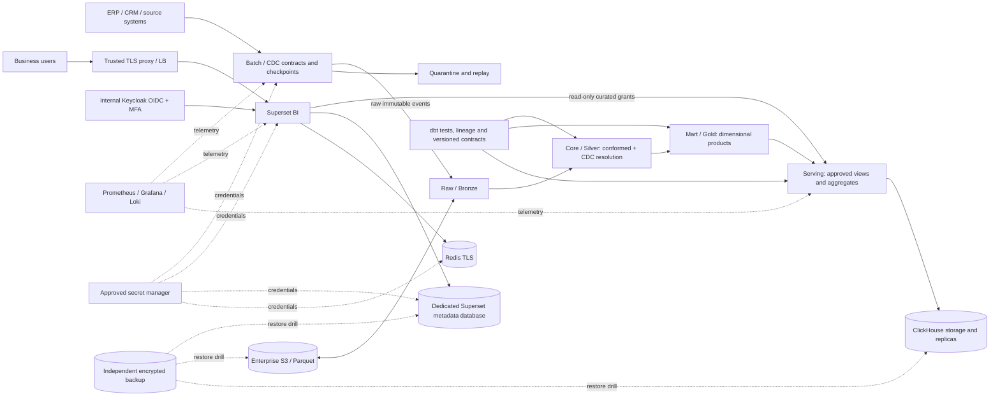

# KingPac Enterprise Insight & Data Warehouse — Architecture Review

**วันที่:** 20 พฤศจิกายน 2026 · **สถานะ:** proposed architecture และ risk review เพื่อพัฒนา/ตรวจรับ; ไม่ใช่ certification, production readiness, benchmark หรือ production deployment. ข้อเท็จจริงจาก source code เป็นข้อสังเกต ณ commit/worktree ที่ตรวจ ไม่ยืนยันสภาพของระบบที่ deploy จริง. [AGENTS.md](../../AGENTS.md) เป็นนโยบายหลัก

**ผู้เชี่ยวชาญที่จัดทำ:** [A13 Software Architecture](../../agents/software-architecture.md) ร่วมกับ [A14 Data Warehouse Architecture](../../agents/data-warehouse-architecture.md). ผู้ร่วม review ที่ต้องประสานภายหลัง ได้แก่ A01/A02/A06/A08/A10 และผู้รับผิดชอบระบบ; บทบาท agents ไม่แทน human sign-off

## 1. เป้าหมายและขอบเขต

เป้าหมายคือ governed, self-hosted business analytics โดยใช้ ClickHouse/dbt ที่มีอยู่และ Apache Superset สำหรับ BI, Grafana สำหรับ observability. ให้ผู้ใช้เห็นข้อมูลที่มี owner, นิยามและสิทธิ์ชัดเจน พร้อมวัด correctness, latency, availability และ recovery ได้. Business data ต้องผ่าน data products ใน `mart`/`serving`; Superset metadata เป็นข้อมูลของแอป ไม่ใช่ source of truth ของยอดขาย

ข้อกำหนด organizational values เช่น owners, source identifiers, capacity, actual endpoints, latency/freshness per dataset, recovery budgets, retention และ security classification เป็น **TBD** จนผู้รับผิดชอบยืนยัน. Repository และ statements ของผู้ใช้ไม่ยืนยัน topology หรือสุขภาพ live

## 2. Target logical architecture

Diagram เป็น target ไม่ได้ยืนยัน ingestion, data isolation, SSO, dashboards หรือ monitoring ใน production. PostgreSQL HA และ Redis TLS มีตามที่ผู้ใช้แจ้ง แต่ยังไม่ได้ยืนยัน endpoints, owners, placement, capacity หรือ failover. ภายใต้นโยบาย single-host ทั้ง UAT และ stack ชื่อ prod-single เป็น DEV/UAT; production target ต้องมี ClickHouse 1 shard × 2 replicas และ Keeper quorum 3 nodes ข้ามอย่างน้อย 3 failure domains พร้อม replicated tables, independent storage และการทดสอบจริง. การมีหลาย container บน host เดียวไม่ใช่ HA

### Integration & deployment decisions

| Boundary | Target / decision | Current evidence / unresolved |
|---|---|---|
| Business BI | Superset → approved ClickHouse serving views, account least privilege | [`04_rbac_and_row_policies.sql`](../../sql/init/04_rbac_and_row_policies.sql) ให้ `mart.*`/`serving.*` กว้าง และ branch policy เป็น comment |
| Metadata | PostgreSQL database + role แยกสำหรับ Superset; schema migration ทำโดย authorized operator | UAT อยู่ใน BI stack; ใช้ source PostgreSQL instance ร่วมได้ใน UAT เมื่อแยก DB/user, backup, capacity และ lifecycle; ยังไม่ implement shared mode |
| Cache | Redis แยก authorization/key namespace และ capacity; session/cache/broker semantics ตาม use case | UAT Redis ใน BI stack; production Redis TLS ตาม user report แต่ไม่ใช่หลักฐาน HA. Redis shared prefix ไม่ใช่ security boundary |
| Identity | Keycloak OIDC, group mapping, MFA enforced at IdP, revocation and least privilege | [`prod_config.py`](../../insight/prod_config.py) มี candidate mapping/PKCE; ยังไม่ทดสอบ Keycloak/MFA/role revoke จริง |
| Network | trusted TLS proxy strips forwarded headers; one explicitly verified proxy hop; host-local access/network controls | [`insight-prod`](../../compose/docker-compose.insight-prod.yml) ใช้ host network/loopback, secret files; target DNS, CA, proxy และ UID permissions ต้องทดสอบบน Linux จริง |
| Operational | GitHub → Jenkins → Harbor → Trivy → Portainer Git stacks; observability, independent backups and restore | CI/scan/restore ที่มีใน code ไม่ใช่หลักฐานว่า pipeline หรือ DR production ผ่าน |

## 3. Warehouse contracts และ correctness

**Contract ต่อ data product** ต้องมี owner/steward, purpose, source, classification/allowed consumers, documented grain และ stable business key, event/ingestion time และ timezone, currency/unit, status/deletion rules, SLA freshness, schema version/evolution, deduplication/order guarantees, lineage, tests, retention, access controls และ incident contact. ค่าที่ source/owner ไม่ยืนยันให้เป็น TBD; source line ID ต้องไม่เดาจาก order ID หรือ product ID

| Layer | ขอบเขตเป้าหมาย | Acceptance evidence |
|---|---|---|
| raw | source-aligned append-only + technical metadata ตาม AGENTS; batch IDs/checkpoints และ immutable or replayable events | completeness by source batch, schema contract, loss/replay/deletion tests |
| core | resolve identity/CDC versions รวม tombstone, deterministic tie-break; conformed entities | duplicates, equal timestamp, out-of-order, update/delete and replay scenarios |
| mart | fact grain ชัดเจน เช่น sales **order line** เมื่อ source identity รองรับ; conformed dimensions, SCD choice ตาม domain | uniqueness by approved key, relationships, cross-source collisions, row counts/value reconciliation |
| serving | governed views/aggregates, minimum grants และ resource limits | authorized vs denied role/branch queries, cache/export/API tests และ certified KPI |

**ปัญหาที่ต้องแก้ก่อนรับรอง KPI:** [`silver_orders_cleaned.sql`](../../dbt/models/silver/silver_orders_cleaned.sql) ใช้ replacing sort key `(order_date, branch_id, order_id)` โดยไม่มี source และ line identity, filter `_is_deleted = 0` ก่อน resolve versions; [`gold_sales_summary.sql`](../../dbt/models/gold/gold_sales_summary.sql) อ่านโดยไม่มี explicit `FINAL`/`argMax`. รูปแบบนี้เสี่ยงสูญเสีย order lines, นับ versions ซ้ำ หรือทำให้ deletion ถูกมองผิด ขึ้นกับ source และ merges. ยืนยัน grain/source key, version ordering และการจัดการ tombstones กับ Data Owner แล้วทำ shadow/backfill และ reconciliation ก่อน cutover; ห้ามใช้ `FINAL` เป็นคำตอบโดยอัตโนมัติโดยไม่ทดสอบ delete semantics และ performance

[`metrics.yml`](../../semantics/metrics.yml) กำหนด net revenue, completed orders และ AOV แต่ [gold model](../../dbt/models/gold/gold_sales_summary.sql) กรอง `order_status != 'CANCELLED'` และแหล่ง `mart.fact_sales` มีข้อจำกัด status ตาม [BI architecture](KINGPAC_ENTERPRISE_INSIGHT_PLATFORM.md). ยืนยัน order identity ข้าม source, net amount, cancellation/returns, currency/timezone และ cutoff กับ Finance/Data Owner; อย่ารวม distinct counts รายวันเพื่อแทน distinct ทั้งช่วงหรือเฉลี่ย AOV รายวันแบบไม่ถ่วงน้ำหนัก

**P0 reconciliation:** [`reconciliation.py`](../../data_quality/reconciliation.py) คืน `ERROR` เมื่อ query ล้มเหลว แต่ converter อาจเปลี่ยนเป็น 0 แล้วคำนวณ `PASSED`; ต้องเปลี่ยนเป็น explicit failure/unknown, ไม่ publish DQS 100% จาก failed inputs และมี negative test รวม timeout/permission/invalid result ก่อนใช้เป็น release gate. กฎ raw vs fact ต้องนิยาม grain, deletions และช่วงเวลาให้ถูกต้อง ไม่ใช่ใช้ row count เท่ากันโดยอัตโนมัติ

**P0 ingestion:** [`postgres_connector.py`](../../ingestion/connectors/postgres_connector.py) ใช้ `watermark > timestamp` กับ `LIMIT` ไม่มี stable tie-break; เมื่อ batch boundary มีเวลาเท่ากันอาจข้ามแถว และ exception ถูกจับแล้วคืน list ว่าง. ออกแบบ checkpoint แบบ `(timestamp, stable_unique_key)` พร้อม deterministic ordering, transaction/upper-bound strategy, late arrivals/replay และ error propagation; ข้อสมมติเรื่อง source timestamp/key ต้องให้ owner ยืนยัน และแหล่งที่ต้องการ CDC จริงต้องเลือก snapshot/log-based approach ที่ทดสอบได้

[`base_connector.py`](../../ingestion/connectors/base_connector.py) ยังมี local checkpoint และเลือก `order_timestamp` ก่อน `updated_at` สำหรับ state ทั้งที่ PostgreSQL extraction ข้างต้นใช้ `updated_at`; ต้องทดสอบ restart/state-save failure, duplicates, partial writes และ replay พร้อมออกแบบ durable checkpoint ให้เป็น consistency contract. Connector template มีค่า default account ระดับ admin/placeholder และ HTTP endpoint: ห้ามถือว่าปลอดภัยสำหรับ production จนกำหนด least privilege, secret handling และ TLS ที่ตรวจจริง

[`03_materialized_views.sql`](../../sql/init/03_materialized_views.sql) ใช้ `countState(order_id)` ซึ่งนับจำนวนแถว ไม่ใช่ distinct orders; การรวม daily distinct values ด้วยการบวกไม่ให้ distinct ของทั้งช่วง. Incremental materialized views ต้องทดสอบ correction/delete และ backfill เป็นพิเศษ; อย่าคาดว่าจะสะท้อน mutation ของ source ย้อนหลังโดยอัตโนมัติ. ห้ามรับรอง `serving.total_orders` จนแก้และทดสอบ. [`02_medallion_tables.sql`](../../sql/init/02_medallion_tables.sql) ต้องให้ owner ตรวจ status/line identity และอนุมัติ retention/TTL รวม legal hold ก่อนใช้ KPI หรือ policy จริง; DDL มี TTL ลบข้อมูลหลัง 7 ปีซึ่งต้องทบทวนก่อน apply

## 4. Security และ trust boundary

| Threat/control | Target and test |
|---|---|
| Cross-branch/department access | ออกแบบ DB-enforced boundaries ด้วย accounts/views ที่แยกตาม data product หรือ verified identity propagation; shared BI account อย่างเดียวไม่สื่อ Superset user ไป ClickHouse. ทดสอบ SQL Lab, direct API, virtual datasets, chart, exports, cache และ Grafana ด้วยผู้ใช้ต่างกลุ่ม: unauthorized rows = 0 |
| Identity & session | Keycloak confidential client, OIDC/PKCE, validated issuer/audience/claims และ MFA policy ที่ IdP; ทดสอบกลุ่มผิด/ไม่มีสิทธิ์, disabled account, session expiration/revocation. Role sync ตอน login ไม่ใช่ immediate revocation |
| Privilege & transport | curated object grants, no raw/core, TLS verify hostname/CA, secrets manager, access review; ทดสอบ bad CA, expired cert และ network denied. Review Alpha/Admin roles เป็น privileged |
| Logging & delivery | audit subject/action/outcome โดยไม่ log tokens/PII, CI scan/SBOM and signed-off release; avoid secret in Git or logs |

## 5. Quality objectives, performance และ DR

ค่าต่อไปนี้เป็น **proposed acceptance targets** ไม่ใช่ผลวัดหรือ SLA ที่อนุมัติ. กำหนด dataset sizes, query set, cold/warm cache, concurrency, network, test duration, host sizing และ error budget ก่อนทดสอบ

| Objective | Target / evidence | Owner |
|---|---|---|
| Dashboard latency | Pilot P95 ≤ 5 วินาที, 20 concurrent users จาก workload ที่ตกลง; แยก client/network/ClickHouse และ cold/warm | BI + SRE |
| Correctness | 100% approved reconciliation cases; multi-line/order, duplicate, cross-source, late update/delete, cancellation, NULL/zero ต่างกัน; no false pass on query error | Finance + Data Owner |
| Security | 0 unauthorized rows ใน negative test matrix ทุกช่องทาง; SSO/MFA/offboarding and TLS failure cases | Security + Data Owner |
| Recovery | RPO ≤ 1h / RTO ≤ 4h เป็นเป้าหมายเบื้องต้นรอ owner sign-off; ทดสอบ timed, non-destructive restore จาก independent backup รวม metadata และ matching Superset key | SRE + DBA |
| Availability | target/measurement window และ fault scenarios TBD; ทดสอบ host, ClickHouse replica/Keeper quorum, PG/Redis, proxy และ restoration | SRE + Platform |

Performance engineering ให้ใช้ `EXPLAIN`, `system.query_log`, representative filter/time/branch patterns และคำนวณ query rows/bytes, memory, CPU, concurrency และ cache effectiveness ก่อนเลือก partition เดือนและ `ORDER BY`; high-cardinality identifier ไม่ใช้เป็น partition. ประเมิน materialization/aggregate states, merges, incremental backfill และ resource quotas โดยเปรียบเทียบ correctness และค่าใช้จ่าย. ห้ามอ้างว่าเร็วขึ้นหรือ HA ผ่านจากการออกแบบเท่านั้น

## 6. Standards alignment ที่เสนอ

| Reference | การนำมาใช้ | Evidence ที่ต้องจัดทำ |
|---|---|---|
| [ISO/IEC 25010:2023](https://www.iso.org/standard/78176.html) | ใช้ quality model ตั้ง requirements, measures และ acceptance | NFR catalog, workload definition, test results และ owners |
| [ISO/IEC 27001:2022](https://www.iso.org/standard/27001) | ข้อมูลนำเข้าสำหรับ governance/risk management ขององค์กร | risk register, owners, access reviews, incident/backup evidence; ประเมินโดยองค์กร ไม่ใช่การรับรองจากเอกสารนี้ |
| [NIST CSF 2.0](https://www.nist.gov/publications/nist-cybersecurity-framework-csf-20) | จัด cybersecurity outcomes ด้าน govern, identify, protect, detect, respond, recover | current/target profiles, gap owner, incident/recovery exercises |
| [OWASP ASVS 5.0](https://asvs.owasp.org/) | คัดเลือก application security verification requirements ตาม scope/risk | versioned requirement IDs, threat model และผลตรวจโดย Security |

เป็นการอ้างอิงสำหรับออกแบบและ review ไม่ใช่ claim ว่า ISO certified หรือผ่าน ASVS. ต้องมีการกำหนด scope, assessment และ evidence โดยเจ้าของระบบ/ผู้ประเมินที่มีอำนาจ

## 7. Prioritized delivery และ independent gates

| ลำดับ | งาน | Deliverable / exit gate | Backward compatibility / rollback |
|---|---|---|---|
| P0-1 | A14/A02 + Data Owner: keys, CDC/delete semantics, KPI contract | approved contract + negative cases; shadow outputs reconcile | ใช้ model/view ใหม่คู่ของเดิม; เก็บ checkpoint และรองรับ replay; ห้าม overwrite data เดิมโดยไม่มีแผน |
| P0-2 | A14/A04/A08: fail-closed reconciliation และ safe incremental extraction | simulated errors/duplicates/late events ไม่ถูกนับว่าผ่าน; source completeness verified | version interfaces, retain original checkpoints; migration/rewind และ destructive change ต้องอนุมัติ |
| P0-3 | A13/A06 + Security: least-privilege BI identity และ isolation | independently tested role/branch matrix ทุกทาง รวม shared accounts และ exports | เพิ่ม scoped roles/views คู่ของเดิม; เปลี่ยน connection หลัง test; rollback grants ต้องไม่เปิดข้อมูลกว้าง |
| P0-4 | A13/A05/A07: OIDC/TLS/secret/proxy integration | UAT positive/negative SSO, MFA, CA, revoked users และ observability evidence | UAT isolated clients; rollback Git SHA/image digest/config ไม่ลบ volume |
| P0-5 | A05/A06: artifact provenance และ registry failure handling | ตรวจ auth/network error ของ registry แยกจาก tag ที่ไม่มีอยู่ และบังคับ reviewed immutable digest ก่อน promote | คง release เดิม; ห้าม overwrite tag ที่เผยแพร่แล้ว; ทดสอบ sandbox registry |
| P1 | A03/A07: load/capacity, ClickHouse replicated DDL, recovery | benchmark report, cross-host failover และ independent backup restore drill | documented RPO/RTO, versioned migrations, data-compatible rollback หรือ restore พร้อมยอมรับ data loss ตาม owner |
| P1 | A10: Power BI parity และ user adoption | inventory, DAX/export/scheduling gaps, approved dashboard reconciliation/UAT | parallel run; cutover per report มี owner sign-off |

ไม่มี schedule commitment จนระบุทีมและ dependency. Scheduled reporting/Celery ยังไม่ implement ใน production candidate; เพิ่มเฉพาะเมื่อกำหนด delivery security/recipients แล้ว. เปลี่ยน production, destructive migration, grants/credentials และ security exception ต้องผ่าน human approval และ independent challenge ตาม AGENTS

**Production blocking gate:** แม้ตารางใช้ P1 เพื่อเรียงลำดับงานวิศวกรรม การสร้าง replicated tables/DDL, HA ข้าม failure domains, พิสูจน์ failover และ non-destructive restore จาก independent backup เป็นข้อบังคับที่ต้องผ่านก่อน production promotion ตาม AGENTS ไม่ใช่งานที่เลื่อนไปทำหลังเปิด production traffic

## 8. Handoff Contract

- **Scope & Sources Inspected:** Repository policy, UAT/production candidates, ClickHouse SQL security, dbt models, metrics catalog, ingestion, reconciliation, BI runbooks และ standards official pages; ไม่ตรวจ live infrastructure
- **Assumptions & Decisions:** Existing architecture เป็น foundation; separate source vs metadata; shared PostgreSQL UAT เป็นทางเลือกที่ต้อง implement/test; actual enterprise endpoints/owners/sizing TBD
- **Security & Operational Impact:** เอกสาร/agent briefs เท่านั้น ไม่เปลี่ยน deployment, schemas, grants, credentials หรือ storage; P0 controls ยังไม่ผ่าน
- **Validation Commands & Results:** Static file inspection และ independent design review ตาม change record; ไม่ได้รัน benchmark, SSO, RLS, restore, production tests หรือ vulnerability scan
- **Remaining TBDs & Residual Risks:** source line identity, data-quality/replay, tenant isolation, semantics sign-off, threat and reliability validation, resource sizing และ operations; ดูลำดับ P0/P1 ข้างต้น
- **Human Approval Required:** Data Owner/Finance, Software/Data Architects, Security, Platform/SRE/DBA และ CAB ตามขอบเขต; ผู้เขียนไม่สามารถรับรอง production ได้เอง
