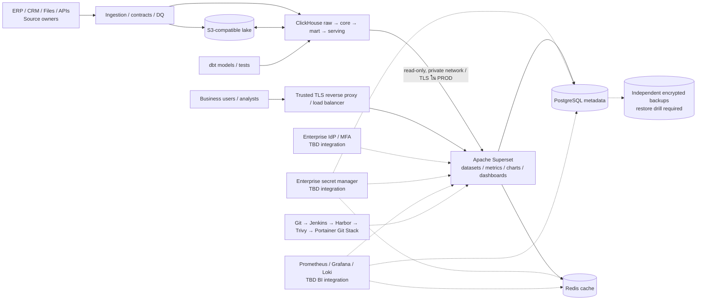

# KingPac Enterprise Insight Platform — Solution Architecture

**สถานะ:** แบบเป้าหมายสำหรับองค์กร พร้อม implementation ตั้งต้นเพื่อ UAT; ยังไม่ใช่ production deployment หรือหลักฐานการทดสอบระบบจริง

KingPac Enterprise Insight Platform เป็นชั้น Enterprise BI บน Apache Superset ที่ใช้ Enterprise Data Lakehouse Platform เดิมเป็นแหล่งข้อมูลกลาง: source systems → ingestion → ClickHouse `raw`/`core`/`mart`/`serving` → governed datasets, charts และ dashboards. Grafana ยังคงใช้สำหรับ observability ของระบบ ส่วน Superset ใช้สำหรับการวิเคราะห์ทางธุรกิจ

โครงการมี [production datasource Compose candidate](../../compose/docker-compose.prod-datasources.yml) สำหรับ PostgreSQL, MySQL, SQL Server และ MongoDB ซึ่งเป็น source systems ของเส้นทางข้างต้น และมี optional Redis single-node profile สำหรับทดสอบ BI; profile นี้ไม่ใช่ HA และไม่แทน Redis TLS เดิมโดยอัตโนมัติ. Superset ต้องอ่าน business data ผ่าน ClickHouse `mart`/`serving` ที่อนุมัติ ไม่เชื่อมต่อ source database เหล่านี้โดยตรง. PostgreSQL HA และ Redis TLS สำหรับ Superset ที่ผู้ใช้แจ้งว่ามีอยู่ต้องให้ DBA ระบุ endpoint และยืนยันว่าเป็นบริการใด; ห้ามสมมติว่า single-container `source-postgres` ในไฟล์นี้คือ PostgreSQL HA

ได้รับเนื้อหารายงานวิเคราะห์ Power BI ที่ผู้ใช้คัดลอกมาแล้วเมื่อ 19 พฤศจิกายน 2026 และเทียบข้อเสนอ/สถานะไว้ใน [PoC และ acceptance plan](../implementation/KINGPAC_INSIGHT_POC_PLAN.md). รายงานเป็นข้อเสนอ ไม่ใช่หลักฐานว่า feature, benchmark หรือ production controls ผ่านแล้ว

## 1. Architecture และขอบเขต

| ชั้น | หน้าที่ | สถานะที่ส่งมอบ |
|---|---|---|
| Lakehouse | คัดกรอง แปลง ทดสอบ และให้บริการข้อมูล | ใช้ DDL/dbt ที่มีอยู่; pipeline และคุณภาพข้อมูลต้องตรวจตามโดเมน |
| BI application | สำรวจข้อมูล สร้าง dataset, chart และ dashboard | Superset 6.1.0 UAT image/Compose และชุด dashboard ตัวอย่าง |
| Metadata | เก็บ dashboard, dataset, role และ connection ของ Superset | PostgreSQL บน host เดียวใน UAT; ผู้ใช้แจ้งว่ามี PostgreSQL HA สำหรับ PROD แล้ว แต่ endpoint, PITR และการเชื่อมต่อยังต้องยืนยัน |
| Cache | เก็บ chart/filter/explore cache | Redis ส่วนตัวใน UAT; ผู้ใช้แจ้งว่ามี Redis TLS สำหรับ PROD แล้ว แต่ topology และการเชื่อมต่อยังต้องยืนยัน |
| Identity / access | SSO, MFA, บทบาท, data authorization | UAT ใช้ local admin; PROD candidate มี Keycloak group mapping แต่ยังต้องทดสอบ SSO/MFA จริง และ RLS ยังไม่ได้ implement |
| Operations | CI, deployment, monitoring, backup/DR | มี image build ใน UAT workflow และ runbook; production integrations และ drills ยังต้องทำ |

UAT stack ใช้ Docker network ภายในแยก metadata/Redis และต่อ Superset เข้ากับ network รวมของ Lakehouse เพื่ออ่าน ClickHouse. พอร์ตเว็บ `18088` bind ที่ loopback ของ host โดยค่าเริ่มต้น; การให้ผู้ใช้อื่นเข้าต้องใช้ trusted TLS reverse proxy ที่ผู้ดูแลตั้งค่าและอนุมัติ. UAT บน host เดียว **ไม่ใช่ HA**. ไม่มี worker/Celery beat, scheduled reports, browser screenshots, SSO หรือ RLS สำเร็จรูปในชุด UAT นี้

### เป้าหมาย production ที่ยังต้องออกแบบและพิสูจน์

- ระบบข้อมูลต้องมี ClickHouse 1 shard × 2 replicas และ Keeper 3 members ในอย่างน้อย 3 failure domains ตาม [Production Architecture](PROD_ARCHITECTURE.md); HA ของ ClickHouse ไม่ทำให้ Superset หรือ metadata เป็น HA โดยอัตโนมัติ
- ออกแบบ Superset อย่างน้อยสอง instance ข้าม failure domains ภายใต้ internal TLS load balancer, metadata PostgreSQL HA/PITR, Redis HA และ shared secret/key ที่จัดการจาก secret manager โดยทีม platform; เลือก topology และทดสอบ failover จริงก่อนอนุมัติ
- ออกแบบ Celery workers, broker/result backend, **single active scheduler** และ browser rendering เฉพาะเมื่ออนุมัติความต้องการ scheduled reports/alerts; กำหนด email, egress, retention และสิทธิ์ข้อมูลของผู้รับก่อนเปิดใช้
- กำหนด IdP, OIDC/LDAP ที่ผ่านการทดสอบ, group-to-role mapping, MFA, offboarding, session policy และ account break-glass; ค่า issuer/client/DNS และ enterprise identity policy เป็น `TBD`
- เชื่อม observability และ audit ไปยังระบบที่องค์กรอนุมัติ พร้อม health checks, error/latency/queue/DB/Redis metrics และ alert routing; การมี Grafana/Loki ใน repo ยังไม่ยืนยันว่ารับ telemetry ของ BI แล้ว
- เชื่อม PostgreSQL backup/PITR และ secret-key recovery กับ independent encrypted object storage; แยก key, environment และสิทธิ์. Backup, HA และ RPO/RTO ยังไม่ยืนยันจน restore/failover drill ผ่าน
- CI/CD เป้าหมายเป็น GitHub → Jenkins → Harbor → Trivy → Portainer Git Stack ตามนโยบาย repository. GitHub Actions ที่เพิ่มให้เป็นทางเลือก UAT เท่านั้น ไม่ใช่หลักฐานว่า production pipeline หรือ vulnerability scan ผ่าน; image base และ direct driver versions ถูก pin แต่ transitive dependencies ยังไม่มี lockfile/hash และต้องจัดการก่อน production

## 2. Business data products และการย้ายจาก Power BI

| ขั้น | สิ่งที่ต้องส่งมอบ | ผู้รับผิดชอบ / เกณฑ์ |
|---|---|---|
| 1. Inventory | รายชื่อ Power BI workspaces/reports, sources, refresh, viewers, DAX/RLS, exports, subscriptions และ dependencies | BI owner; inventory จริง `TBD` |
| 2. Define | เลือก pilot, owner, semantic contract, grain, currency/timezone และ reconciliation | Data owner/Finance อนุมัตินิยามและ source of truth |
| 3. Build | เตรียม dbt marts/serving, Superset datasets/metrics และ dashboard | Data engineering + BI; ทดสอบข้อมูลและสิทธิ์ |
| 4. Compare | รันขนานกับ Power BI สำหรับช่วงและตัวกรองเดียวกัน | Business owner อนุมัติ tolerance, performance และ UAT evidence (`TBD`) |
| 5. Cutover | อบรม, สื่อสาร, สนับสนุน, freeze และ rollback ตามแผน | Owner/CAB อนุมัติวัน cutover และ retention |

Superset ไม่รับประกันความเทียบเท่ากับ Power BI โดยอัตโนมัติ: DAX, semantic model, RLS, paginated reports, subscriptions, embedding, Excel export และ workflow เดิมต้องจัดรายการ ทดสอบ และออกแบบทดแทนเป็นรายกรณี; อย่าเลิกใช้รายงานเดิมจน reconciliation และ acceptance ผ่าน

## 3. Pilot dashboard และนิยามตัวอย่าง

ชุดตัวอย่างสร้าง dashboard **KingPac Sales Overview — UAT** โดยอ่าน `mart.fact_sales` และเริ่มต้นช่วง 30 วันที่ผ่านมา พร้อม time/branch filters. ยังไม่ publish อัตโนมัติและไม่ได้ certify ให้ใช้ตัดสินใจทางธุรกิจ

| ตัวชี้วัด UAT | Expression | ความหมาย/ข้อจำกัด |
|---|---|---|
| Sales amount | `sum(amount)` | ผลรวมค่า amount ที่มีใน fact; เงินตราและการรับรู้รายได้ยังไม่ยืนยัน |
| Distinct source-order pairs | `uniqExact(_source_system, order_id)` | จำนวนคู่ source และ order ในช่วงที่กรอง; ไม่ยืนยันว่าเป็น completed orders |
| Distinct customer IDs | `uniqExact(customer_id)` | distinct IDs ในผลลัพธ์; ไม่ยืนยัน customer master เดียวกันข้ามแหล่ง |
| Quantity | `sum(quantity)` | รวม quantity ของ fact; หน่วยและการแปลงหน่วยยังต้องตรวจ |

`serving.v_daily_branch_sales` เป็น aggregate ตามวัน/สาขา: `total_orders` ใช้ `countState(order_id)` ซึ่งนับแถว ไม่ใช่ distinct order และ `unique_customers` เป็น distinct ของแต่ละกลุ่ม จึงห้ามนำค่าลูกค้ารายวันมาบวกเพื่อแทน distinct ลูกค้าทั้งช่วง. ตัวอย่างนี้คำนวณ distinct จาก fact โดยตรง; สำหรับ scale ให้ทีมข้อมูลออกแบบ mergeable states หรือ serving model ที่ทดสอบแล้ว

`mart.fact_sales` ไม่มี status และ sample loader อาจ insert ซ้ำหากรันซ้ำ จึงยังพิสูจน์ไม่ได้ว่า amount ตัดรายการยกเลิกครบ deduplicate แล้ว หรือเท่ากับ `net_revenue` ใน [semantic catalog](../../semantics/metrics.yml). Catalog เป็นข้อเสนอ ไม่ใช่หลักฐานว่า formula ผ่านการรับรอง; อย่าแสดง KPI ว่าเป็น net revenue/completed orders จน owner ตรวจ pipeline และ reconciliation

dbt `gold_sales_summary` ปรับ AOV จากค่าเฉลี่ยต่อ line เป็นยอดรวมต่อ distinct order ตาม catalog แบบ provisional แล้ว แต่ silver sorting key ไม่มี line identifier และ status filter ยังไม่ยืนยัน completed orders. ตรวจ [data correctness gates](../implementation/KINGPAC_INSIGHT_POC_PLAN.md) และให้ owner อนุมัติก่อนใช้เป็น KPI จริง

## 4. Security และ data governance

- BI connection ต้องใช้ service account แบบ read-only จำกัด `mart`/`serving`; `bi_user` ที่มีอยู่ใน UAT ได้สิทธิ์ทั้งสอง schema และควรลดสิทธิ์ตาม data product ที่อนุมัติเมื่อเข้าสู่ PROD. ห้ามใช้ ClickHouse admin
- การใช้ ClickHouse service account เดียวหมายความว่า ClickHouse มองทุก Superset user เป็น account เดียว; ห้ามอ้างว่า ClickHouse บังคับ branch-level per-user isolation ในรูปแบบนี้. ออกแบบ database-enforced isolation ด้วย identity/credentials ที่เหมาะสม หรือแยก data products/accounts ตามขอบเขต; ทดสอบ positive/negative access ทุกเส้นทาง
- Superset RBAC/RLS เป็นส่วนหนึ่งของ controls แต่ไม่ควรใช้ UI filter เป็น security boundary; ปิด SQL Lab สำหรับ connection ตัวอย่างและอย่าให้ผู้ใช้สร้าง connection/dataset หรือเข้าถึง raw/core นอกขอบเขต. ทดสอบ direct chart, SQL Lab, exports, APIs และ cache ว่าไม่ข้ามสิทธิ์
- UAT Redis ไม่มี authentication/TLS และใช้ Docker private network เท่านั้น; metadata และ Redis ไม่ publish host ports. สำหรับ PROD ต้องมี network isolation, authenticated encrypted connections, approved secrets และการ hardening/ตรวจสิทธิ์เพิ่มเติม
- UAT secrets ผ่าน environment variables และผู้ที่มีสิทธิ์ Docker/Portainer ระดับดู container อาจเข้าถึงได้; จำกัดสิทธิ์ผู้ดูแลและใช้กลไกส่ง secrets ที่องค์กรอนุมัติสำหรับ production
- Secret key ของ Superset แยกแต่ละ environment และต้องเก็บคู่กับ metadata backup เพื่อถอดรหัส connection credentials หลัง restore. ห้าม commit secrets หรือพิมพ์ `docker compose config` แบบแสดงค่าจริงลง logs

## 5. Rollout และ acceptance gates

1. **UAT foundation:** build image, ตรวจ Compose, bootstrap, test ClickHouse connection และ dashboard ด้วย synthetic/masked data ตาม [runbook](../../runbooks/07_kingpac_insight_uat.md)
2. **Pilot data product:** owner รับรอง grain, KPI, source, RLS และผลเทียบ Power BI; บันทึกจำนวน rows, ช่วงเวลา, ข้อแตกต่างและความสดของข้อมูล
3. **Enterprise hardening:** ทำ SSO/MFA, RBAC/RLS, audit, TLS, network allowlist, secret injection, monitoring, backups, sizing และ load/failover tests ใน topology ที่อนุมัติ
4. **Production promotion:** แนบ CI/image scan, metadata + ClickHouse restore และ reconciliation evidence, RPO/RTO ที่ business owner อนุมัติ, rollback/cutover และ human sign-off. RPO ≤ 1 ชั่วโมง และ RTO ≤ 4 ชั่วโมงเป็นเป้าหมายรอ business sign-off ไม่ใช่ผลการทดสอบ

### Compatibility, volumes และ rollback

ชุด BI เป็น stack เพิ่มเติม ไม่เปลี่ยน DDL, ClickHouse volume หรือ schema เดิม. PostgreSQL metadata ใช้ named volume ใหม่ `insight_metadata`; Redis เป็น cache ชั่วคราว. การรัน `superset db upgrade` เปลี่ยน metadata schema และอาจไม่ backward-compatible กับ image เก่า. ก่อน upgrade ต้อง backup PostgreSQL แบบสอดคล้องกับ key และทดสอบ restore; การเปลี่ยน Git ref/image กลับอย่างเดียวไม่ย้อน schema, dashboards หรือ credentials. ห้ามลบ volume เพื่อแก้ปัญหา

## 6. References

- [Apache Superset 6.1.0 release](https://github.com/apache/superset/releases/tag/6.1.0)
- [Superset ClickHouse integration](https://superset.apache.org/docs/databases/supported/clickhouse/)
- [Superset configuration and metadata database](https://superset.apache.org/docs/configuration/configuring-superset/)
- [Superset security and row-level security](https://superset.apache.org/admin-docs/security/)
- [Superset caching](https://superset.apache.org/docs/configuration/cache/)

## Handoff Contract

- **Scope & Sources Inspected:** รายงานที่ผู้ใช้คัดลอก, Lakehouse architecture, UAT Compose, SQL fact/serving/RBAC, dbt, semantic catalog และเอกสาร Superset
- **Assumptions & Decisions:** Pilot เป็น sales UAT จาก fact เดิม; PostgreSQL/Redis บน UAT host เดียว; production topology เป็นเป้าหมาย
- **Security & Operational Impact:** เพิ่ม BI metadata volume และ read-only consumer; ไม่มี RLS/SSO/HA สำเร็จรูป; ต้องมี TLS, least privilege และการทดสอบ negative access
- **Validation Commands & Results:** ดูผลจริงใน handoff ของงานและบันทึก change; architecture เองไม่ยืนยัน runtime, security scan หรือ restore
- **Remaining TBDs & Residual Risks:** KPI/sign-off, line identity/CDC, DNS/IP, IdP, secrets, sizing, production BI topology, scheduling, RLS, backup/PITR และ RPO/RTO
- **Human Approval Required:** Data Owner/Finance, BI, Security, Platform/SRE, DBA, Network และ CAB ก่อน production promotion
