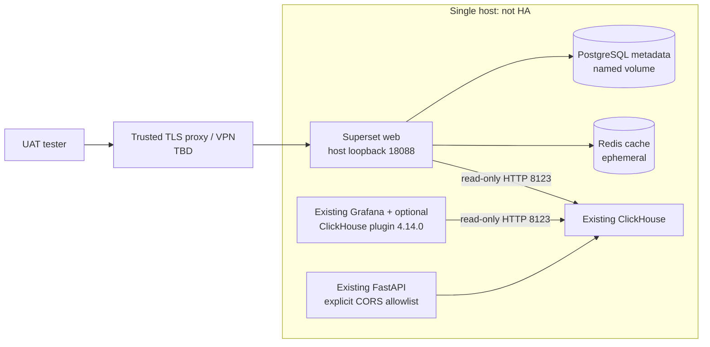

# KingPac Enterprise Insight Platform — Deployment Blueprint

**สถานะ:** UAT artifacts ผ่านการทดสอบ local synthetic บางส่วน; production เป็น target design ยังไม่มี organizational UAT deployment, scan หรือ failover evidence. ดู [ADR 0006](../../adr/0006-kingpac-enterprise-insight-platform.md) และ [PoC/acceptance plan](../implementation/KINGPAC_INSIGHT_POC_PLAN.md)

## 1. DEV/UAT topology



| Artifact | Purpose / boundary |
|---|---|
| [Superset Compose](../../compose/docker-compose.insight-uat.yml) | New UAT stack; PostgreSQL and Redis on private network; Superset also connects to Lakehouse integration network |
| [Superset image](../../insight/Dockerfile) | Superset 6.1.0, ClickHouse driver, application config, bootstrap and optional demo tools |
| [Grafana override](../../compose/docker-compose.insight-grafana-uat.yml) | Optional override for existing observability stack using a separately built image; preserves existing data volume |
| [Grafana image extension](../../monitoring/grafana/Dockerfile.insight-uat) | Builds on approved UAT Grafana image, installs plugin 4.14.0 and includes provisioning file |
| [API CORS configuration](../../api/main.py) | Exact origin allowlist for browser requests; does not authenticate/authorize API calls |
| [Branch audit](../../insight/check_branch_isolation.py) | Read-only UAT verification of two separately provisioned accounts; does not create policies |

Superset stack และ Grafana override ไม่จำเป็นต้อง deploy พร้อมกัน. Bootstrap passwords/keys และ ClickHouse accounts ส่งผ่าน secret manager/Portainer environment ที่จำกัดสิทธิ์; environment variables อาจมองเห็นได้โดยผู้ที่มี Docker/Portainer administrative access. ห้ามใช้ production credentials ใน UAT

### Grafana UAT image และ datasource

Grafana image เดิมใช้ 11.1.4 และ stack เดิมตั้ง `GF_INSTALL_PLUGINS` โดยไม่ระบุ plugin version. Grafana ระบุว่า plugin 4.15+ ต้องใช้ Grafana 11.6+; optional image นี้ pin 4.14.0 สำหรับ baseline 11.1.4 และปิดการติดตั้ง plugin แบบ unpinned ตอน container เริ่ม. ดู [Grafana plugin requirements](https://grafana.com/docs/plugins/grafana-clickhouse-datasource/latest/) และ [provisioning reference](https://grafana.com/docs/plugins/grafana-clickhouse-datasource/latest/configure/). ต้อง build/scan/test compatibility จริงก่อนใช้

ตัวอย่าง build บน UAT build host หลังตั้ง `GRAFANA_UAT_IMAGE` เป็น approved base image/digest:

```bash
docker build --build-arg GRAFANA_BASE_IMAGE="$GRAFANA_UAT_IMAGE" \
  -f monitoring/grafana/Dockerfile.insight-uat \
  -t kingpac-grafana-insight:uat .
```

Publish ไป UAT registry แล้วกำหนด `GRAFANA_INSIGHT_UAT_IMAGE`, `INSIGHT_GRAFANA_CH_HOST`, `INSIGHT_GRAFANA_CH_USER`, `INSIGHT_GRAFANA_CH_PASSWORD` ใน secret-managed environment. ค่า host ต้อง resolve ไป ClickHouse บน shared observability network; UAT template ใช้ HTTP `8123` และ `serving` database. ผู้ดูแลสร้าง dedicated read-only ClickHouse account ที่มีสิทธิ์เฉพาะ objects ที่ได้รับอนุมัติ; ไม่ใช้ admin. Grafana ส่ง SQL ตามผู้ใช้ จึงต้อง enforce สิทธิ์ที่ ClickHouse ด้วย

```bash
docker compose --env-file /secure/path/kingpac-observability.env \
  -f compose/docker-compose.observability.yml \
  -f compose/docker-compose.insight-grafana-uat.yml config --quiet
```

`/secure/path/...` เป็น path ตัวอย่าง. Base Compose ยังต้องมี image variables เดิม รวม `GRAFANA_UAT_IMAGE` แม้ override image. ใช้ Git-backed Portainer stack ที่รองรับ compose overrides หรือให้ผู้ดูแลจัดทำ reviewed equivalent โดยคง environment placeholders; ห้ามบันทึก output ของ `docker compose config` ที่มี secret ลง Git/logs

Plugin อยู่ `/opt/kingpac-grafana-plugins` เพื่อไม่ถูก Grafana named volume เดิมบัง. การเปลี่ยน `GF_PATHS_PLUGINS` ทำให้ plugins อื่นที่เคยติดตั้งใน `/var/lib/grafana/plugins` ไม่ถูกโหลดใน image นี้; inventory และ bake plugins ที่ต้องการก่อน rollout. Rollback กลับ image/path เดิมและ retain volume. Grafana datasource ใช้ `$INSIGHT_GRAFANA_CH_PASSWORD` สำหรับ single-pass environment expansion เพื่อไม่ขยาย `$` ใน password ซ้ำ; การ provision มิใช่หลักฐานว่า connection/permissions ใช้ได้จริง

## 2. API CORS และ compatibility

`API_CORS_ALLOWED_ORIGINS` รับ comma-separated exact `http://` หรือ `https://` origins โดยไม่มี path และไม่รับ `*`. ค่า default ว่างทำให้ browser ข้าม origin ไม่ได้รับ CORS permission; `API_CORS_ALLOW_CREDENTIALS` default `false` และรับ `true`/`false`. ตัวอย่าง values ขององค์กรเป็น `TBD`; บันทึกใน Portainer environment และ redeploy เฉพาะ UAT หลัง owner review

นี่เป็น breaking change สำหรับ browser clients ที่เคยใช้ wildcard: ต้องเพิ่ม origin ที่อนุมัติและทดสอบ preflight ก่อนเปลี่ยน image. Server-to-server และ same-origin traffic ไม่พึ่ง CORS. API ปัจจุบันยังไม่มี application authentication/authorization ที่พิสูจน์แล้ว และ host port อาจถูก publish; CORS ไม่ป้องกัน direct requests. ต้องมี approved authentication, authorization และ network controls ก่อนเปิดข้อมูลจริง

## 3. Production target — ยังไม่ implement

- **Web tier:** Superset มากกว่าหนึ่ง instance ข้าม failure domains หลัง internal TLS load balancer; ไม่สมมติว่า Docker Compose บนหลาย host จัดการ failover อัตโนมัติ. CI/Portainer จัดการ deployment บนแต่ละ host ตาม topology ที่ review
- **Metadata/cache:** PostgreSQL HA/PITR และ Redis HA ที่แยกจาก application hosts, TLS/auth และ independent encrypted backup. Secret key ต้องตรงกันระหว่าง instance ใน environment เดียวและกู้คืนคู่ metadata; แยกจาก environment อื่น
- **Scheduling เมื่อได้รับอนุมัติ:** Celery workers, broker และ results backend ที่ใช้ร่วมกัน; Celery beat มีเพียง **one active scheduler** พร้อม failover plan; ติดตั้ง supported headless browser, กำหนด SMTP/email policy, recipients, egress และทดสอบ report delivery/authorization. UAT stack ปัจจุบันไม่มีองค์ประกอบเหล่านี้
- **Identity/data authorization:** enterprise IdP + MFA, group-to-role mapping และ offboarding; dedicated service accounts หรือ verified identity propagation, curated views และ database-enforced isolation ตาม access model ที่ Security/Data Owner รับรอง. ต้องทดสอบ query/export/API/SQL Lab/cache ทั้ง positive และ negative
- **Observability and recovery:** BI availability/error/latency, PostgreSQL/Redis and worker health, logs/audit, alert routing และ backup/PITR/restore drill. Superset local test แจ้งว่า rate limiter ใช้ in-memory storage; production หลาย instance ต้องกำหนด shared rate-limit backend และทดสอบ. กำหนด business RPO/RTO และทดสอบ failover ใน failure domains จริง
- **Delivery:** GitHub → Jenkins → Harbor → Trivy → Portainer Git Stack; pin release image digest, lock/hash dependencies, record SBOM/scan, approvals, tested migrations และ rollback. UAT GitHub workflow ไม่ใช่ production pipeline

## 4. Deployment/rollback gates

1. Review ADR, security model, exact image digests, data owners, KPI contracts, network and identity design
2. สำรอง metadata PostgreSQL กับ Superset secret key อย่างสอดคล้องกันไป independent encrypted storage; ทดสอบ restore ใน isolation และบันทึกผล. Backup จะไม่ถือว่าเชื่อถือได้จน restore ผ่าน
3. ใน UAT เท่านั้น build images, validate Compose, initialize metadata, connect read-only ClickHouse, import demo และรันทดสอบตาม [runbook](../../runbooks/07_kingpac_insight_uat.md)
4. ทดสอบ P95, 20 users, 100% approved reconciliation cases และ 0 unauthorized results ตาม PoC plan; บันทึก actual outputs
5. ก่อน migration/rebuild dbt gold table หรืออัปเกรด Superset metadata ต้องประเมิน compatibility และ backup; Git/image rollback ไม่ย้อน schema หรือ data. ห้ามลบ volumes เพื่อแก้ deployment
6. Production promotion ต้องมี independent review และ Data Owner, Security, Platform/DBA, Network และ CAB sign-off ตามนโยบาย repository

## 5. Organization-specific inputs

DNS/IP/CIDR, IdP issuer/client, TLS certificate/CA, secret manager integration, service-account ownership, user groups/branch entitlements, approved Grafana base image, S3/KMS/retention, test dataset and size, workload profile, business RPO/RTO และ go-live date: **TBD**

## Handoff Contract

- **Scope & Sources Inspected:** รายงานที่ผู้ใช้คัดลอก, UAT Compose/Grafana/API/dbt, Superset/Grafana official docs และ AGENTS.md
- **Assumptions & Decisions:** UAT ใช้ host เดียวและ HTTP ภายใน; production HA/identity/scheduling เป็น target แยก
- **Security & Operational Impact:** เพิ่ม metadata volume และ optional plugin path; CORS default เปลี่ยนเป็น deny; RLS ยังไม่ implement; rollback schema ต้องใช้ backup ที่ verified
- **Validation Commands & Results:** Syntax/config checks และ unit tests มีใน [status](../implementation/KINGPAC_INSIGHT_IMPLEMENTATION_STATUS.md); ไม่มี runtime/restore/scan evidence
- **Remaining TBDs & Residual Risks:** Actual hosts/DNS/IdP/secrets, grants, KPI/CDC, image build, plugin compatibility, SSO, HA, load และ DR
- **Human Approval Required:** Independent engineering reviewer, Data Owner/Finance, BI, Security, Platform/DBA, Network และ CAB ก่อน production
