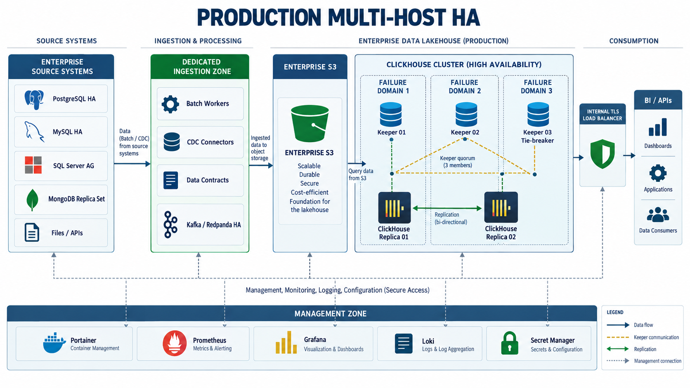
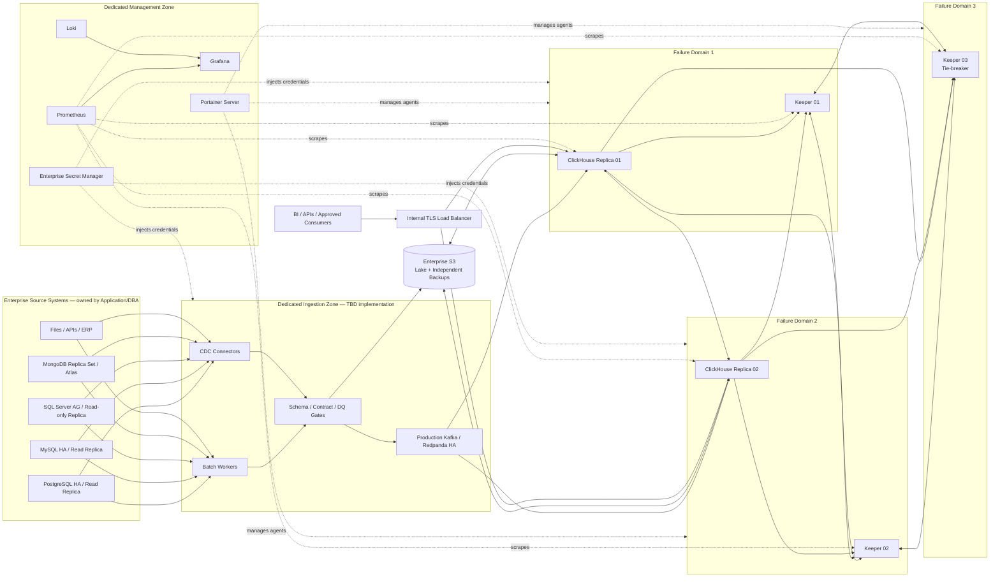
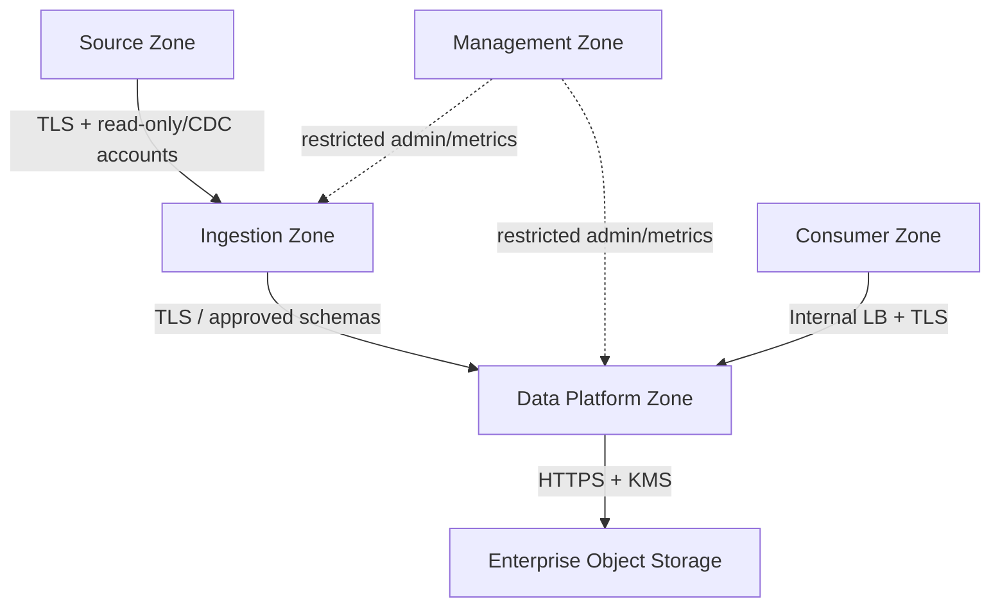

# Production Architecture Design — Multi-Host HA

> [คู่มือติดตั้งและใช้งาน PROD ทีละโหนด](../PROD_INSTALLATION_AND_OPERATIONS_GUIDE.md) มีรายละเอียด host prerequisites, published-port matrix, ลำดับ bootstrap และเกณฑ์ตรวจรับ. ภาพ/ผังในเอกสารนี้เป็น target architecture จนกว่าจะมีผลทดสอบ multi-host จริง.

## 1. เป้าหมายและขอบเขต

สถาปัตยกรรมเป้าหมายสำหรับ Production ใช้ ClickHouse 1 shard x 2 replicas และ
ClickHouse Keeper 3 members บน independent failure domains ระบบต้นทางเป็นระบบองค์กร
หรือ managed databases ที่อยู่นอก Lakehouse cluster ไม่ deploy UAT datasource containers
บน ClickHouse hosts

> [!CAUTION]
> ภาพนี้เป็น target architecture ไม่ใช่หลักฐานว่า Production พร้อมใช้งาน Repository
> ยังมี blocking gaps ตาม Production Deployment Runbook

## 2. Logical Architecture

## 3. Ownership and Placement

| Component | Placement | Owner |
|---|---|---|
| PostgreSQL/MySQL/SQL Server/MongoDB | Existing enterprise DB platforms or managed services | Application Owner / DBA |
| Read replicas/CDC endpoints | Dedicated source-side infrastructure | DBA |
| Ingestion/CDC workers | Dedicated ingestion zone, not ClickHouse hosts | Data Platform |
| ClickHouse Replica 01 | Failure Domain 1 | Data Platform |
| ClickHouse Replica 02 | Failure Domain 2 | Data Platform |
| Keeper 01-03 | One member per failure domain | Data Platform |
| Enterprise S3 and backup | Independent storage service | Storage/Cloud Platform |
| Portainer/Observability | Dedicated management zone | Platform/SRE |

## 4. Network Zones

Keeper ports `9181/9234`, interserver `9009`, metrics `9363` และ Portainer Agent
`9001` เป็น private-only ports ห้ามเปิดสู่ Internet

## 5. Availability and Data Protection

- Keeper ใช้ 3-member Raft quorum ข้าม failure domains
- ClickHouse มี 2 replicas และต้องตรวจ replication queue/delay
- Internal load balancer ส่ง traffic เฉพาะ healthy replicas
- Enterprise S3 แยกจาก ClickHouse local disks
- Backup ส่งตรงไป independent object storage
- Backup จะเชื่อถือได้เมื่อ restore drill และ reconciliation ผ่านจริง
- RPO `<= 1 hour` และ RTO `<= 4 hours` ต้องมี business owner sign-off

## 6. Security Model

- Source accounts เป็น read-only หรือ CDC-specific; ห้ามใช้ root/sa
- Secrets มาจาก enterprise secret manager
- TLS สำหรับ source connections, load balancer, S3 และ management traffic
- Least-privilege ClickHouse roles แยก admin, ETL, BI, API, monitoring และ backup
- Network allowlist แยก Source, Ingestion, Data Platform, Consumer และ Management zones
- Production images pin patch/digest และผ่าน vulnerability scan
- Portainer ใช้ SSO/MFA/RBAC และ audit logging

## 7. Current Repository Gaps

ก่อน deploy Production ต้องปิดอย่างน้อย:

1. Pin ClickHouse/Keeper patch versions และ image digests
2. สร้าง approved Production observability topology
3. สร้าง Production ingestion/CDC deployment
4. แยก/validate Keeper configuration สำหรับแต่ละ process/node
5. กำหนด enterprise S3/KMS, TLS และ load balancer
6. รัน multi-host connectivity, load, failover และ restore tests

สถานะปัจจุบัน: **NOT READY FOR PRODUCTION**

## 8. Deployment Reference

ดู readiness gates และลำดับ deploy ที่
[Production Portainer Deployment Runbook](../../runbooks/04_portainer_prod_deployment.md)

## Handoff Contract

- **Scope & Sources Inspected:** PROD Node 1/2, Keeper 3, Keeper/cluster config และ governance baseline
- **Assumptions & Decisions:** Sources อยู่นอก Lakehouse; 3 independent failure domains
- **Security & Operational Impact:** Private east-west network, TLS, secret manager และ least privilege เป็น mandatory
- **Validation Commands & Results:** เป็น target architecture; ยังไม่มี runtime/failover evidence
- **Remaining TBDs & Residual Risks:** PROD ingestion, observability, IP/DNS/CIDR, TLS, S3/KMS, LB และ sizing
- **Human Approval Required:** Architecture, Platform, DBA, Security, Network, Storage, Data Owner และ CAB
