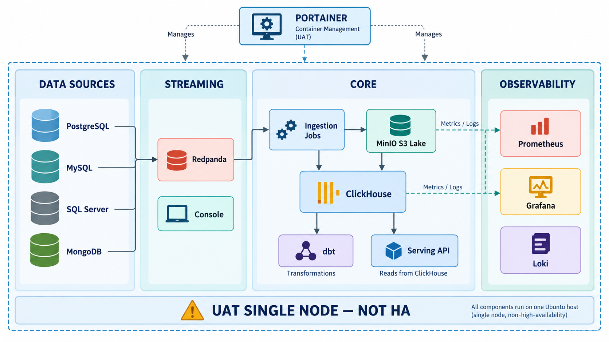
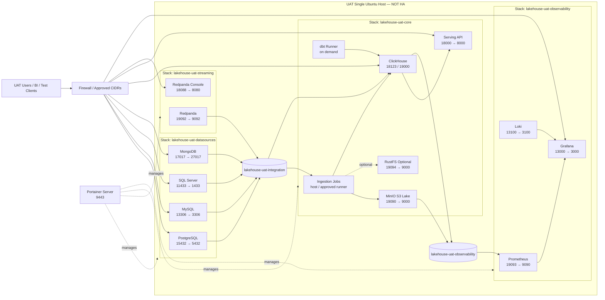

# UAT Architecture Design — Single Node

## 1. เป้าหมายและขอบเขต

สถาปัตยกรรมนี้ใช้สำหรับ functional test, integration test, data validation และ
performance baseline บน Ubuntu 24 LTS host เดียว ไม่ใช่ High Availability และไม่ใช้
Production PII ที่ไม่ได้ mask

## 2. Logical Architecture

## 3. Portainer Stack Boundary

| Stack | Lifecycle ownership | Persistent state | Shared network |
|---|---|---|---|
| Shared Docker networks | Platform/DevOps | None | Integration + Observability |
| Core | Data Platform | ClickHouse, MinIO | Integration + Observability |
| Core optional profile | Data Platform | RustFS | Integration + Observability |
| Data Sources | UAT/DBA | PostgreSQL, MySQL, SQL Server, MongoDB | Integration |
| Streaming | Data Platform | Redpanda log | Integration |
| Observability | SRE | Prometheus, Grafana, Loki | Observability |

Platform/DevOps ต้องสร้าง shared external networks บน UAT Docker endpoint ก่อน จากนั้น
deploy Core, Data Sources, Streaming และ Observability ตามลำดับ

## 4. Data Flow

1. UAT source databases เก็บ synthetic หรือ masked datasets
2. Ingestion jobs อ่านผ่าน application accounts และเขียน raw data ไป MinIO/ClickHouse
3. Redpanda รับ streaming events และ ClickHouse Kafka integration ประมวลผล
4. dbt แปลงข้อมูลจาก raw ไป core, mart และ serving
5. Serving API/BI อ่านเฉพาะ approved serving/mart objects
6. Prometheus scrape ClickHouse/MinIO; Grafana อ่าน Prometheus และ Loki

ปัจจุบัน ingestion jobs เป็น scripts/approved runner ไม่ใช่ long-running service ใน
Compose และ Loki ยังไม่มี log shipper ใน UAT Compose ต้องเพิ่ม collector ก่อนอ้างว่า
centralized logging ครบวงจร

## 5. Failure and Recovery Boundary

ทุก volume อยู่บน host เดียว จึงไม่ป้องกัน host/disk failure การ restart containers
ช่วยเฉพาะ process failure เท่านั้น Backup ต้องส่งออกไป independent object storage และ
ต้องมี non-destructive restore drill

## 6. Security Controls

- จำกัด external ports ด้วย firewall/VPN และ approved CIDRs
- ใช้ TLS reverse proxy สำหรับ web/API endpoints ที่ออกนอก trusted network
- เก็บ secrets ใน Portainer/approved secret manager ไม่ commit ลง Git
- ใช้ non-root/non-SA application users
- ห้ามใช้ Production PII โดยไม่มี masking approval
- Portainer `9443` เปิดเฉพาะ management network

## 7. Deployment Reference

ดูขั้นตอนติดตั้งที่ [UAT Portainer Deployment Runbook](../../runbooks/01_portainer_git_stack_deployment.md)

## Handoff Contract

- **Scope & Sources Inspected:** UAT Core, Data Sources, Streaming และ Observability Compose
- **Assumptions & Decisions:** Single host, synthetic/masked data และไม่ใช่ HA
- **Security & Operational Impact:** External access ต้องผ่าน firewall/VPN/TLS
- **Validation Commands & Results:** Diagram สอดคล้องกับ Compose topology; runtime ยังต้องพิสูจน์บน UAT host
- **Remaining TBDs & Residual Risks:** DNS/IP, CIDRs, TLS, external backup และ log shipper
- **Human Approval Required:** Platform, Security, DBA และ Data Owner ก่อน UAT sign-off
