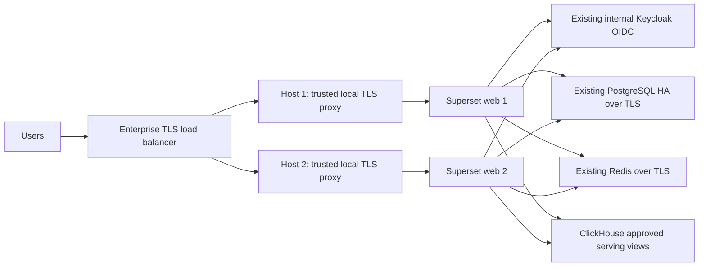

# KingPac Enterprise Insight Platform: production candidate runbook

**Status: design and implementation candidate; NOT approved or validated for production.** This runbook is a reviewable change plan, not permission to deploy. Follow [AGENTS.md](../AGENTS.md) and obtain Data Owner, Security, Platform Owner and CAB approvals before promotion. No production command has been run.

## Architecture and responsibility

Host count, capacity, placement and load-balancer configuration are **TBD**. At least two independently failing web hosts are needed for web availability; validate their failover. The existing ClickHouse HA requirement remains three independent failure domains and a three-member Keeper quorum. PostgreSQL HA and Redis TLS were reported available by the owner; their topology, failover and sizing have not been verified. No HA is claimed for this candidate.

## Existing datasource stack

The repository already has [docker-compose.prod-datasources.yml](../compose/docker-compose.prod-datasources.yml): `source-postgres`, `source-mysql`, `source-mssql`/initializer and `source-mongodb` provide source-system candidates on an external `lakehouse-prod-integration` network. Their intended business-data path is **source → approved ingestion/CDC → ClickHouse raw/core → dbt mart/serving → Superset**. Neither the actual ingestion connection nor production deployment has been verified. Do not grant Superset direct access to these source databases.

This source stack is single host; its `source-postgres` has one PostgreSQL container, not a defined HA cluster. It does not establish that this source PostgreSQL is the separately reported PostgreSQL HA service for Superset metadata. DBA must identify the actual metadata endpoint and, if an existing PostgreSQL HA service is shared, provision an isolated metadata database, dedicated account, resource limits, TLS and backup/restore under approval. Never repurpose the source database or credentials by assumption.

The stack also contains an **optional, single-node** `insight-redis` profile. It is a candidate for isolated functional testing and is not HA; it must not silently replace the existing Redis TLS service reported by the owner. `docker compose --profile insight-redis` enables it, subject to the review and gates below. The default profile does not start it. An approved HA design and failover evidence are required before using it for production availability.

### Optional Redis candidate inputs and controls

- Set `INSIGHT_REDIS_IMAGE` to an approved Redis image by immutable digest, with TLS and `redis-cli` support; its intentionally invalid placeholder prevents accidentally pulling an unapproved image. Set `PROD_BIND_IP` to an approved private host address and optionally `INSIGHT_REDIS_PORT` (default 16379). The private published port still needs an approved source allowlist. DNS name and certificate SAN must match the `rediss://` hostname. The Superset host-network deployment cannot assume Docker alias resolution; provision approved DNS and routing.
- Provision absolute files outside Git for `INSIGHT_REDIS_CA_SOURCE`, `INSIGHT_REDIS_CERT_SOURCE`, `INSIGHT_REDIS_KEY_SOURCE`, `INSIGHT_REDIS_ACL_SOURCE` and `INSIGHT_REDIS_HEALTH_PASSWORD_SOURCE` through the secret manager. The ACL file must disable the default user, define a least-privilege `healthcheck` user permitted to run `PING`, and provide separate appropriately scoped application users. Its healthcheck password must match the health password file. Review commands/key patterns with Security and validate Superset's Redis session, cache and rate-limit operations before granting access. Never put real ACL passwords into the repository or command history. Test file ownership/readability by the Redis process; file-backed Compose secrets preserve host file constraints and are not a secret manager.
- Redis listens only with TLS plus ACL; this candidate explicitly does **not** enforce mutual TLS. The Superset client verifies the server certificate, CA and hostname. Review this choice against the organization's policy; if mTLS is mandatory, implement and test client certificate support before deployment. See [Redis TLS documentation](https://redis.io/docs/latest/management/security/encryption/).
- `insight_redis_data` is a new named volume containing AOF and potentially sensitive session/cache data. Enforce at-rest encryption, storage monitoring, retention and an approved independent backup/restore procedure where required. The `256mb` Redis limit, `512M` container limit and `noeviction` are starting points only: capacity-test them, because rejected writes can break sessions or caching. Single-node container restart is not HA. Password or certificate rotation and Redis data migration require a separate approved plan.
- After the required inputs are set, validate with `docker compose -f compose/docker-compose.prod-datasources.yml --profile insight-redis config --quiet`, scan the selected image and test in isolated UAT, including valid and invalid ACLs, TLS CA/hostname failure, plaintext rejection, restart/recovery, disk-full and memory behavior. Run a least-privilege Superset integration test using `INSIGHT_PROD_REDIS_URI_SOURCE` with the approved DNS endpoint and CA. Do not enable or route production traffic until approved and validated.
- Rollback: remove this optional profile from the approved stack configuration and keep or revert the Superset URI to the previously approved Redis service. Existing datasource services and volumes are otherwise unchanged; retain the Redis volume for the approved retention period. Data written to this Redis will not automatically appear on the prior service, and active sessions may be lost. Never delete the volume without explicit authorization.

Local verification, 2026-11-19: Compose configuration validation passed with dummy environment values, with and without the Redis profile. A disposable Redis 7.4.12 container on an isolated network was run with the Compose service command and generated synthetic TLS/ACL material: authenticated health returned `PONG`, unauthenticated `PING` returned `NOAUTH`, and plaintext did not return `PONG`. The test harness translated Compose's escaped dollar signs for direct `docker exec`; it did not deploy the stack or exercise Portainer, DNS, hostname verification from Superset, the actual ACL policy, persistence recovery or HA. Temporary container and generated credentials were removed. A first harness attempt failed because it passed Compose's literal `$$` through to the shell; the corrected harness passed. No production secret was used.

Security review of the source candidate remains required: its MySQL command explicitly sets `--require-secure-transport=OFF`, PostgreSQL TLS is not configured in this file, source credentials are provided through environment variables, SQL Server defaults to Developer edition, and images/defaults must be assessed against the production digest policy. These observations describe repository configuration, not the live environment. The BI candidate uses host networking; Docker network aliases such as `source-postgres` are not automatically available to it. Approved DNS/routing and network policy are required for ClickHouse and external metadata/cache/identity services; do not attach BI to the source network merely to bypass ingestion.

`compose/docker-compose.insight-prod.yml` is a Linux-host-networked, host-local web service, with no PostgreSQL, Redis or ClickHouse volumes. A separately managed reverse proxy must terminate TLS, only forward trusted `X-Forwarded-*` headers, strip client-supplied versions, and reach the service over host loopback. Network controls must prevent all other clients from reaching it. One proxy hop is configured; change and test proxy settings if the real topology differs. Session and rate-limit state share Redis; metadata share PostgreSQL. Redis prefixes do not isolate tenants: dedicate an appropriately secured instance/ACL and validate resource limits. No built-in scheduling/worker/beat, SMTP, embedding or enterprise portal is implemented by this production candidate.

## Inputs and preparation

Use the [separate production Stack.env template](../deployment/kingpac-insight/README.md); it contains secret **file paths only**, not the secrets or connection strings themselves. The file does not provision external services or constitute deployment approval.

All actual values are TBD and must come from responsible owners, never Git or build arguments:

- `INSIGHT_PROD_IMAGE`: Harbor image **by sha256 digest**, built from a reviewed base also pinned by digest. The local validation tag is not an approved image. CI must build, scan with Trivy, review findings and publish through the existing Jenkins/Harbor process. Compose itself cannot enforce digest format; preflight checks it.
- `INSIGHT_PROD_PORT`: unique host-local port; `INSIGHT_OIDC_ISSUER`, `INSIGHT_OIDC_CLIENT_ID` and three distinct `INSIGHT_OIDC_GROUP_VIEWER`, `INSIGHT_OIDC_GROUP_AUTHOR`, `INSIGHT_OIDC_GROUP_ADMIN`: Keycloak owner supplies exact issuer and group paths. Create a confidential OIDC client with PKCE S256, exact HTTPS redirect URI `https://<approved-host>/oauth-authorized/keycloak`, userinfo group mapper and verified email. Enforce MFA in Keycloak and test it; this app does not itself enforce MFA. The admin group receives Superset Admin; author receives Alpha, a broad role requiring an explicit permission review. Reconcile roles on every login; group removal does not immediately revoke existing sessions. Establish tested session revocation and incident procedures.
- Secret-manager-rendered **absolute file paths**: `INSIGHT_PROD_SECRET_KEY_SOURCE`, `INSIGHT_PROD_METADATA_URI_SOURCE`, `INSIGHT_PROD_REDIS_URI_SOURCE`, `INSIGHT_PROD_OIDC_SECRET_SOURCE`, `INSIGHT_PROD_METADATA_CA_SOURCE`, `INSIGHT_PROD_REDIS_CA_SOURCE`, `INSIGHT_PROD_IDENTITY_CA_SOURCE`. Key is at least 32 characters and identical on all web instances. Store it securely with backups: losing/changing it can make encrypted database credentials unreadable; key rotation needs a separate approved procedure.
- Metadata URI format (place in secret file, percent-encode credentials): `postgresql+psycopg2://<user>:<password>@<hostname>:<port>/<database>?sslmode=verify-full&sslrootcert=/run/secrets/metadata_ca`. Redis: `rediss://<user>:<password>@<hostname>:<port>/0?ssl_cert_reqs=required&ssl_check_hostname=true&ssl_ca_certs=/run/secrets/redis_ca`. Use unique application credentials and a Redis endpoint compatible with the client; failover behavior requires integration testing. Identity trust bundle must contain the CA chain needed to verify Keycloak. The identity host must match its certificate.
- Compose file-backed secrets are bind mounts, not a secret vault. Restrict host ownership and permissions and verify the non-root container UID 1000 can read them; root-owned `0600` files will not work unless the secret provider grants appropriate access. CA files and secrets must not be world-accessible. Avoid printing interpolated Compose config or URIs. Preflight checks file existence/other-user permissions, not readability from the container, certificate validity, secrets quality or connections.
- Create **dedicated ClickHouse read-only accounts scoped to approved curated views**, limit SQL Lab and exports as appropriate, and prove row/department isolation with negative tests. A shared account cannot convey individual user identity by itself. Superset role mapping is not proof of ClickHouse RLS. Deny deployment for sensitive datasets until this boundary is independently verified.

## Change procedure for authorized operators

1. Review the diff, architecture, security model and impact; obtain approved host/DNS/certificates, identity, roles, capacity and secrets. Run the identical image on isolated UAT with a non-production Keycloak client, data, PostgreSQL and Redis. Validate browser views, filters and cross-host sessions, OIDC subject/email/groups, MFA, logout and revoked groups, permissions and SQL Lab bypass attempts. Test expired/wrong-CA certificates and service failover. Reconcile signed-off KPIs with source and Power BI; the source order-line identity and AOV require Data Owner validation.
2. On an approved Linux host, render the above secrets from the authorized secret manager and set non-secret environment variables for the Portainer Git stack. Run `python3 insight/prod_preflight.py`, then `docker compose -f compose/docker-compose.insight-prod.yml --profile maintenance config --quiet`. These are syntax/basic input checks, not readiness certification. Record image digest and reviewed Git commit; do not paste secrets in tickets or logs.
3. Before any production metadata migration, capture a consistent PostgreSQL backup and demonstrate a non-destructive restore in isolation, including the matching Superset key. Obtain explicit migration approval. Schedule maintenance; stop writes, run migration **once**, not concurrently across hosts, then initialize roles. With approved environment, the operator may use `docker compose -f compose/docker-compose.insight-prod.yml --profile maintenance run --rm maintenance` followed by `docker compose -f compose/docker-compose.insight-prod.yml --profile maintenance run --rm maintenance superset init`. Do not use an ad-hoc production deployment to bypass the Git-backed Portainer stack.
4. Promote the reviewed Git revision and digest through the approved Portainer Git stack on each authorized host; check `/health`, load balancer, TLS, login, role/data boundaries, data reconciliation and dashboards. Record release, approval, owners and evidence. Measure the agreed pilot target of 20 concurrent users and P95 <= 5 seconds under a documented workload; neither value is currently verified. Configure monitoring/alerts for HTTP failures/latency, host/container resources, Postgres/Redis health, ClickHouse query failures and audit logs without secrets or sensitive query results.
5. Establish encrypted independent backups, retention and restore tests for PostgreSQL metadata, Superset key and relevant configuration; ClickHouse backups remain subject to the platform DR policy. RPO <= 1 hour and RTO <= 4 hours are proposed targets pending business approval and an actual timed restore drill.

## Rollback and impact

This candidate does not modify existing services, ClickHouse grants or volumes until an operator performs separate changes. Deploying it introduces new web hosts, network traffic and external PostgreSQL/Redis workload; capacity and privileges require review. No local persistent production volume is created by this Compose file. Rolling back an image after a metadata migration is **not necessarily compatible**: follow the approved recovery plan and restore a tested, consistent pre-migration PostgreSQL backup and matching key when required, accepting the documented recovery point and potential loss of post-backup changes. Do not delete volumes or databases. Return traffic to the previously approved service only after verification.

## Open gates

Real Keycloak/MFA, proxy and group integration; PostgreSQL/Redis failover and certificate verification; ClickHouse least privilege and branch/department isolation; load and restore drills; image vulnerability review; business KPI sign-off; operational alerting; and independently reviewed permissions remain outstanding. Scheduled reporting and other Power BI parity workflows require separate design and implementation if needed. No production deployment is authorized by the presence of this file.
